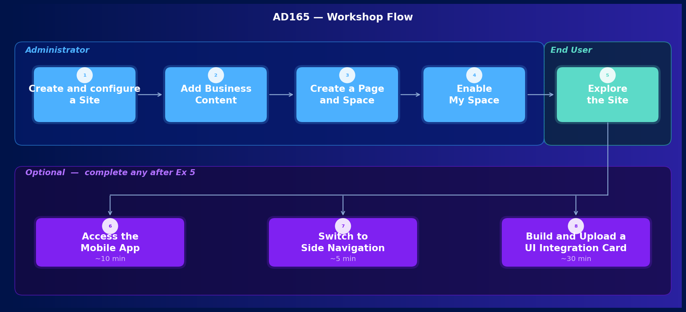

# Getting Started

Welcome to the hands-on session **AD165 - Boost user productivity with AI assistant Joule and personal My Space for SAP Build Work Zone**.

In this introductory section you will get an overview of the session, the tools you will be working with, and your first access to the environment.

---

## About This Session

### SAP Build Work Zone

SAP Build Work Zone helps organizations create modern, AI-powered digital workplace experiences. It centralizes access to business applications, processes, and information in a single unified entry point — reducing context switching and improving the experience for employees who work across multiple SAP systems.

Work Zone sites are organized into **Spaces** and **Pages**: a Space brings together the apps and insights a user needs for a specific business role (for example, *Purchaser* or *Sales Manager*), and each Space contains one or more Pages where the actual content — apps and cards — lives.

### Joule

Joule is SAP's AI copilot embedded across SAP applications. In SAP Build Work Zone, Joule helps users:

- **Find content** — ask questions in natural language instead of navigating through menus
- **Navigate** — get guided directly to the right app or page from a prompt
- **Act** — start workflows such as creating a repair request or reviewing an approval without opening a dedicated app first

### Joule Work Mobile App

The Joule Work mobile app extends the Work Zone experience to iOS and Android devices. Users can access their sites, launch apps, and interact with Joule directly from their phone — with a native app.

---

## What You Will Build

Over the course of this session you will take on the role of a **Work Zone administrator** and an **end user**.

As an administrator, you will:

- **Create a new Work Zone site** and configure it with Joule, language, mobile, and navigation settings
- **Connect business content** from a backend SAP S/4HANA system using the Channel Manager
- **Build a custom page and space** and assign them to a role
- **Upload and configure UI integration cards**
- **Enable the personal My Space** feature

As an end user, you will then explore the site you have built, interact with Joule, and create your own personal page using My Space.

---

## Exercise Overview

| Exercise | Title | Role |
|---|---|---|
| 1 | Create a Site and Configure Basic Settings | Administrator |
| 2 | Integrate Business Content | Administrator |
| 3 | Create a Work Zone Page and Space | Administrator |
| 4 | Enable My Space | Administrator |
| 5 | Explore the Site as an End User | End User |
| 6 *(Optional)* | Access the Site on the Joule Work Mobile App | End User |
| 7 *(Optional)* | Change the Site Navigation to Side Menu | Administrator |
| 8 *(Optional)* | Create, Package, and Deploy Your Own UI Integration Card | Administrator |

---

## Prerequisites

- Access to a pre-configured SAP Build Work Zone environment — your user ID is available on your desk and your password will be provided by the instructor
- Google Chrome browser (recommended)
- No prior experience with SAP Build Work Zone is required

---

## System Access

> [!IMPORTANT]
> Please make sure to open all system links using the browser context menu: right-click and select **Open Link in New Tab** in order to keep this GitHub exercise tab open.

### Your Environment

The hands-on environment for this session consists of:

- **SAP Build Work Zone, standard edition** — the central product you will be configuring and exploring throughout this session
- **SAP S/4HANA Cloud, public edition** — a connected backend system with pre-configured roles and business apps that you will federate into your Work Zone site
- **SAP Business Application Studio** — used in the optional Exercise 8 to package a custom UI integration card

### Steps

1. **Note your user number** — check the card on your desk for your participant number (###) and login credentials. You will use your participant number to name your site and content items throughout the exercises to avoid naming conflicts with other participants.

2. **Open the SAP Build Work Zone admin environment** — you will find the required links in the script. Right-click the link and select **Open Link in New Tab** to keep this exercise page open.

3. **Log in** — enter the username and password from your desk card.

---

## Summary

You are now ready to start the exercises.

Continue to - [Exercise 1 - Create a Site and Configure Basic Settings](../ex1/README.md)
