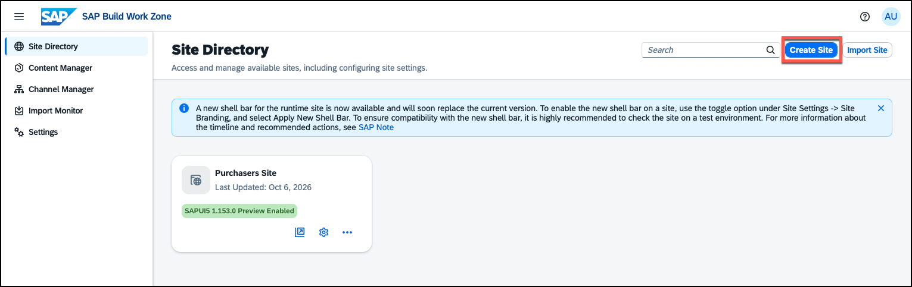
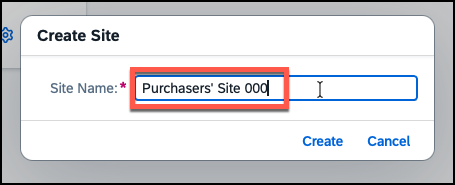
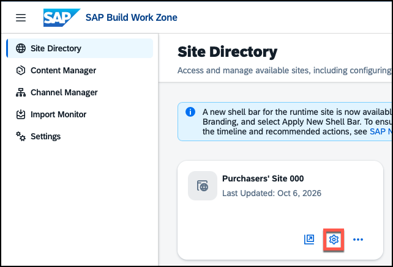
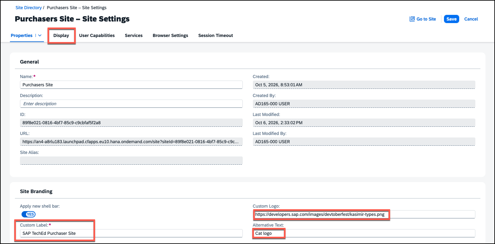
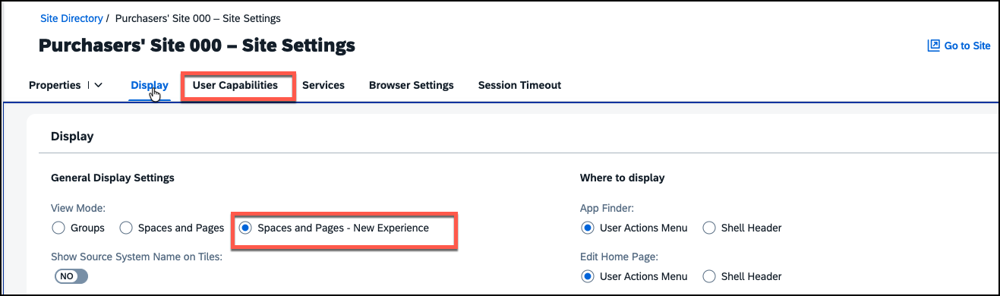
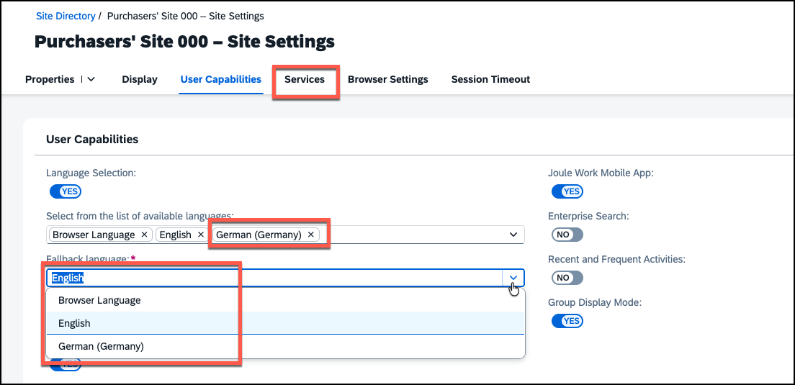
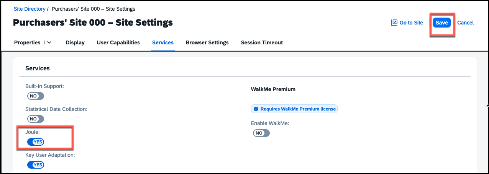

# Exercise 1 - Create a Site and Configure Basic Settings

In this exercise, you will create a brand-new Work Zone site using the New Site Experience and configure the most important site-level settings. This includes enabling the new shell bar, setting the view mode, enabling the AI assistant Joule, setting up language options, and adding a custom logo. At the end of this exercise you will have a configured site ready to receive content.

> [!NOTE]
> SAP Build Work Zone lets you build digital workspace solutions to increase user productivity and engagement. It centralizes access to relevant business applications, processes, and insights in a unified entry point that your users can access from any device.

---

## <a id="exercise-11-create-a-new-site"></a> Exercise 1.1 - Create a New Site (New Site Experience)

### What you'll achieve
After completing these steps you will have created a new Work Zone site using the modern site creation flow.

---

### Steps

1. **Login to SAP Build Work Zone admin environment** — open (in a new window `shift` + `left click`) 👉 <a href="https://an4-a8rlu183.dt.launchpad.cfapps.eu10.hana.ondemand.com/sites#Site-Directory?sap-app-origin-hint=" target="_blank">SAP Build Work Zone</a> and login with the user that is available on your desk and the password provided by your instructors.


2. **Create a site** — You are now in the **Site Directory**: this is where you manage your Work Zone sites. From here you can create new sites, configure site settings (including role assignments and a site alias), and set the default site for the subaccount. The left-hand navigation gives you access to all the other tools in the administration environment — such as the Content Manager and the Channel Manager — which you will explore in later exercises.

   Click **Create Site** to get started.

   

3. **Enter a site name** — use a name of your choice (e.g. **Purchasers' Site ###**, replacing ### with your participant number) and click **Create**.

   

The site is created and you can now get started with defining some key properties.

---

## <a id="exercise-12-new-shell-bar"></a> Exercise 1.2 - Assign a Custom Logo to your Site

### What you'll achieve
After completing these steps your site will display a custom logo, a site label, and the new shell bar will be confirmed active.

---

When a site is created you land directly on **Site Settings**, with the **Properties** tab open by default. The new shell bar is active for new sites by default — it brings a cleaner layout, a unified search experience, and a refreshed user profile menu aligned with the SAP Horizon design system. Under the **Site Branding** section you can assign a custom logo, a label, and alt text.

> [!NOTE]
> For a full overview of what changed in the new shell bar and any migration considerations for existing sites, see the [SAP Community blog post](https://community.sap.com/t5/technology-blog-posts-by-sap/new-shell-bar-in-sap-build-work-zone-what-admins-need-to-know/ba-p/14320131).

### Steps

1. **Switch to Edit Mode** — you are already on **Site Settings** from the previous exercise. Click **Edit** to switch to edit mode.

   > [!TIP]
   > If you navigated away, you can return to Site Settings at any time by clicking the **cog icon** on your site card in the Site Directory.

   

2. **Check New Shell Bar** — on the **Properties** tab, confirm that the **New Shell Bar** toggle is set to **On**.

3. **Add a custom logo** — go to the **Site Branding** section and fill in the following fields:

   - **Custom Logo:**
     ```
     https://developers.sap.com/images/devtoberfest/kasimir-types.png
     ```
   - **Logo Alt Text:** `Cat logo`
   - **Custom Label:** `SAP TechEd Purchaser Site`

   > [!NOTE]
   > The changes to the logo and the label that you just made only apply to the runtime of your site. You can change them for the administration environment only by assigning a complete new theme.


4. **Go to Display tab** — do not save your changes yet, but navigate to the **Display tab** to change some further settings.

   

---

## <a id="exercise-13-display-settings"></a> Exercise 1.3 - Configure Display Settings

### What you'll achieve
After completing these steps your site will use the modern Spaces and Pages navigation experience.

---

The **Display** tab controls how the site is presented to end users and where certain UI options appear. The key settings are:

- **View Mode**: determines the top-level navigation paradigm. **Spaces and Pages - New Experience** is the modern approach: content is organized into *Spaces* (thematic workspaces) and *Pages* (individual pages within a space), giving users a structured, multi-level navigation. The alternative is the classic homepage that shows a flat grid of tiles.
- **Navigation bar**, **User actions menu**, and similar options — these control whether and where navigational elements such as the search bar or the user profile menu are shown in the UI.
- **Preview SAPUI5 Latest Version**: lets administrators enable the latest SAPUI5 version on selected sites for validation. SAPUI5 releases a new version roughly every four weeks; enabling this setting lets you test it for up to two weeks before it rolls out to all productive sites. We will leave this **Off** for this exercise as it is not required.

### Steps

1. **Open the Display tab** — in the **Site Settings**, click the **Display** tab.

2. **Set View Mode** — find the **View Mode** setting and select **Spaces and Pages - New Experience**.

3. **Review the remaining settings** — take a moment to look at the other options on the tab. No further changes are required for this exercise.

4. **Go to User Capabilities tab** — move on to the **User Capabilities** tab for the next settings.

   

---

## <a id="exercise-14-configure-languages"></a> Exercise 1.4 - Configure Languages

### What you'll achieve
After completing these steps your site will support multiple languages.

---

Two changes have recently been introduced to the language selection which is available under the **User Capabilities** tab in Site Settings:

- **Fallback language**: administrators can now define the language the site falls back to if a user selects a language with no available translation.
- **Browser language**: the browser language can now be explicitly added to or removed from the list of available languages. If removed, it will no longer appear as an option in user settings.

### Steps

1. **Find the language settings** — you are already on the **User Capabilities** tab. Scroll down to find the language-related settings.

2. **Set a Fallback language** — choose a language of your preference.

3. **Adjust available languages** — add or remove languages, including browser language, based on your own preferences.

4. **Save your changes.**

5. **Navigate to the Services tab** — move on to the **Services** tab for the next settings.

   

---

## <a id="exercise-15-enable-joule"></a> Exercise 1.5 - Enable Joule

### What you'll achieve
After completing these steps the AI assistant Joule will be activated for your site. Users will be able to ask Joule questions, get help with navigation, and receive contextual assistance directly within the site.

---

> [!NOTE]
> Joule is SAP's AI copilot embedded across SAP applications. In SAP Build Work Zone it helps users find content, summarize information, and navigate the site more efficiently. For users, this means fewer clicks to find the right app or process — they can just ask.

---

### Steps

1. **Switch to Edit Mode** — click the **Edit** button in the upper right corner.

2. **Enable Joule** — locate the **Joule** toggle and set it to **On**.

3. **Save your changes.**

   

---

## Summary

You have created your first Work Zone site and configured the key site-level settings: the new shell bar and custom logo on the **Properties** and **Site Branding** tabs, the **Spaces and Pages** view mode on the **Display** tab, language support, and Joule. Before you take a first look at the site, go and add some business content to it.

Continue to - [Exercise 2 - Integrate Business Content](../ex2/README.md)
