# Exercise 2 - Integrate Business Content

In this exercise, you will first explore the admin environment of SAP Build Work Zone, standard edition. You will then check the connectivity to an SAP S/4HANA Public Cloud system using the Channel Manager, explore the federated content in the Content Manager, assign a content channel and roles to your site, and check the result in runtime to see how business apps appear in your site.

> [!NOTE]
> Content federation in SAP Build Work Zone allows you to pull in roles including all apps, spaces, pages, and catalogs from connected backend systems (such as SAP S/4HANA or SAP SuccessFactors) and surface them to users in a unified, role-based experience. From a user perspective, this means a single place to start the working day, regardless of how many backend systems an organization runs.

---

##  Exercise 2.1 - Get to Know the Admin Environment

### What you'll achieve
After completing these steps you will understand the admin environment of SAP Build Work Zone, standard edition, and know where to manage site content.

---

### Steps

1. **Leave the Site settings**: go back to the **Site Directory** by clicking the link in the breadcrumb.

   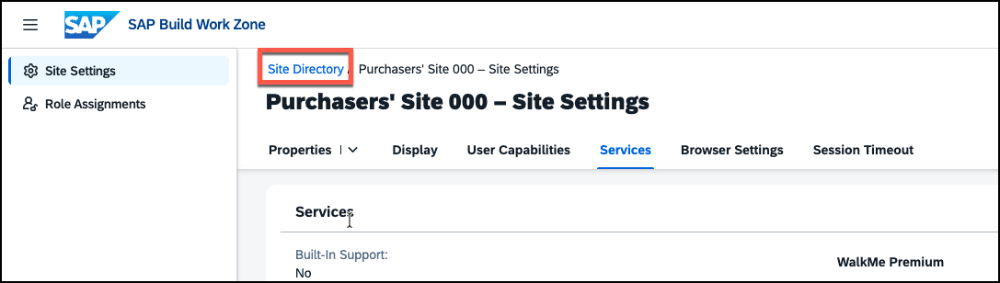

2. **Understand the admin areas**: in the left-hand navigation, you now see the areas **Site Directory**, **Content Manager**, **Channel Manager**, **Import Monitor**, and **Settings**.

   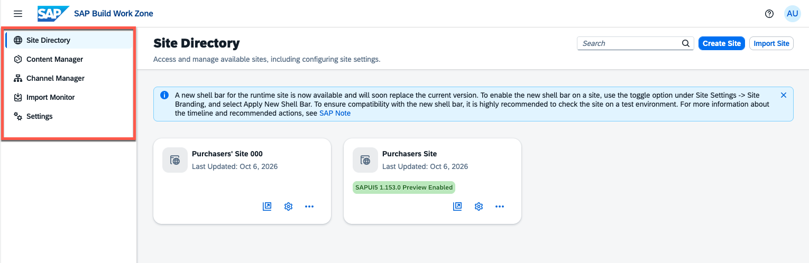

---

Here is a summary of what administrators can do in these different tools:

**Site Directory**
Lists all Work Zone sites in your subaccount. You already used it in the last exercise. From here you create new sites, manage site settings, transport sites, and launch a site in runtime.

**Content Manager**
The central place for creating and managing all content items — pages, spaces, roles, and apps. This is where you create new content and manage what is available in your subaccount. You will use it in Exercise 3.

**Channel Manager**
Manages the connections to backend content providers. This is where you trigger content updates and review the federated content available from each connected system. This is the area you will be using in this exercise.

**Import Monitor**
Helps administrators track past and running imports.

**Settings**
Manage features that affect all the sites in a subaccount, e.g. notification settings, custom domains, and others.

---

##  Exercise 2.2 - Get to Know the Channel Manager and Learn About Federation

### What you'll achieve
After completing these steps you will understand how the Channel Manager works and what federation means in the context of SAP Build Work Zone.

---

Content federation starts on the content provider side, e.g. the SAP S/4HANA system where an administrator defines the **exposure scope**. This can cover all roles in the system, or a selected subset. Regardless of the scope, each exposed role always carries its full assigned content: all apps and catalogs are included. The administrator also decides which navigation structures to expose alongside them — **spaces and pages** (the modern navigation paradigm), **groups** (the classic tile-group layout), or both. Once that exposure configuration is active on the S/4HANA side, the Work Zone administrator creates a **content channel** that points to the S/4HANA system. When the channel is synchronized, all exposed roles and their content become available inside Work Zone and can be assigned to sites and users.

The key benefit of this approach is that **content ownership stays in the backend system**. Roles, apps, and navigation structures are defined and maintained by S/4HANA administrators in the place they know best — Work Zone simply consumes what is exposed. 

### Steps

1. **Navigate to Channel Manager** — in the left-hand menu, click **Channel Manager**.

   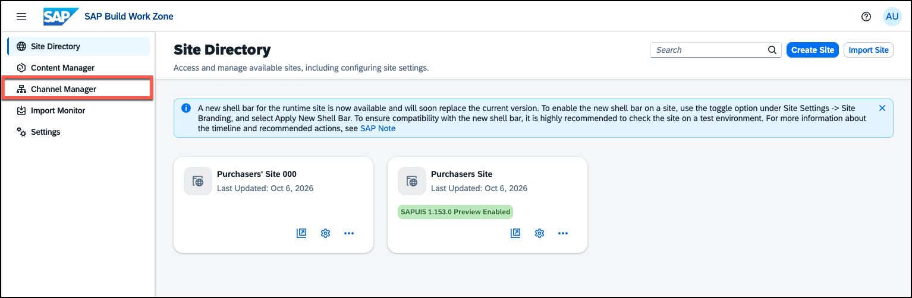

2. **Review the configured channels** — you will see at least three channels:

   **HTML5 Apps**
   When you subscribe to SAP Build Work Zone, standard edition, this provider is created automatically. It starts empty — any app deployed to SAP BTP is added to it automatically, making it available to surface in your site.

   **S4HANA Public Cloud**
   This channel connects to an SAP S/4HANA Public Cloud system and federates role-based content (roles, catalogs, apps, spaces, and pages) into Work Zone. The connection is backed by destinations configured in SAP BTP cockpit.

   **Demo Generic Package**
   This channel was used to bring UI integration cards into the system. UI integration cards are lightweight, embeddable content snippets that can display live data from backend services directly on a Work Zone page. You will work with these cards later in this exercise.

   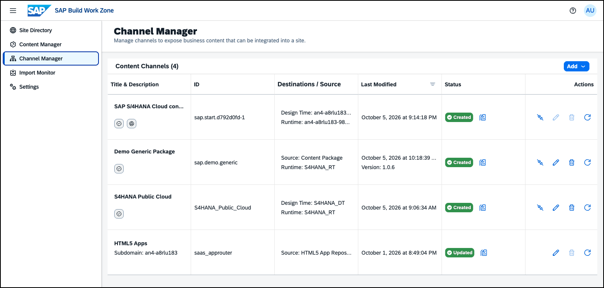

3. **Check the Status column** — note whether each channel is active and when it was last synchronized.

4. **Inspect the S4HANA Public Cloud properties** — click the **pencil icon** on the **S4HANA Public Cloud** channel to open its properties. The key fields to note are:

   - **Provider ID / Name** — unique identifier for this channel
   - **Design Time Destination** — the BTP destination used to fetch roles and content metadata from the backend
   - **Runtime Destination** — the destination used when users actually launch apps (can differ from design time)
   - **Automatically add all content items to subaccount** — it is recommended to set this to *On* to avoid manual selection steps. This setting is planned to be removed in a future release.
   - **Status** — shows whether the channel is active and reachable

   Click **Cancel** to close the properties without making changes.

   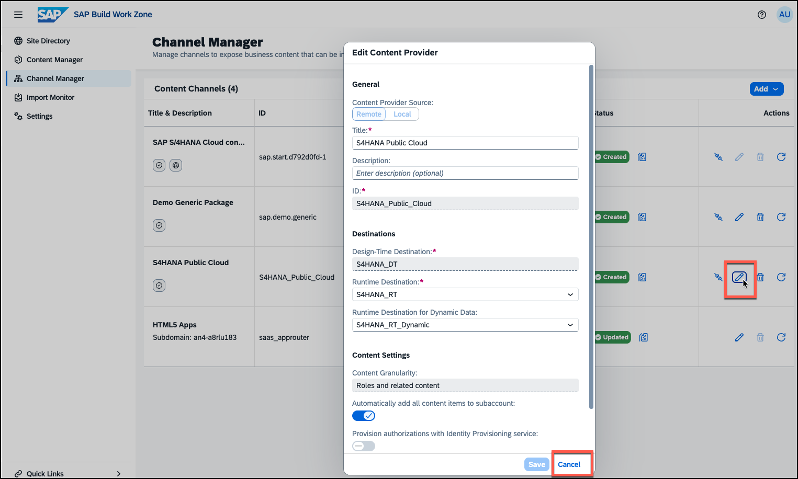

5. **Open the content report** — click the **report icon** on the **S4HANA Public Cloud** channel. Browse the exposed content — you will see the roles, catalogs, and apps that have been federated from the S/4HANA system and are available to assign to your site.

   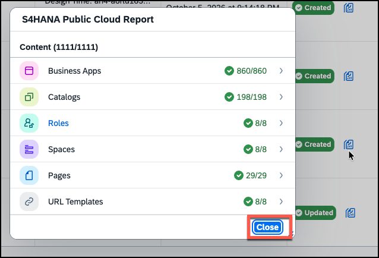

> [!NOTE]
> Content channels need to be set up by an administrator with the appropriate backend connectivity in place. These channels were preconfigured for this session, but you will later add a content package.

---

##  Exercise 2.3 - Explore Federated Content in the Content Manager

### What you'll achieve
After completing these steps you will have seen how federated content from the S/4HANA Public Cloud channel appears in the Content Manager, and you will understand the structure of a federated role.

---

The Content Manager gives administrators a unified view of all content items available in the subaccount — whether created manually or pulled in from a connected backend. You can use the **Provider** filter in the header to narrow the list to content from a specific channel, which makes it easy to verify what has been federated and to inspect individual items.

### Steps

1. **Navigate to Content Manager** — in the left-hand menu, click **Content Manager**.

   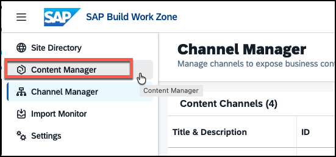

2. **Filter by content provider** — in the Content Manager header, open the **Provider** filter and select **S4HANA Public Cloud**. The list now shows only the roles that were federated from the S/4HANA system.

   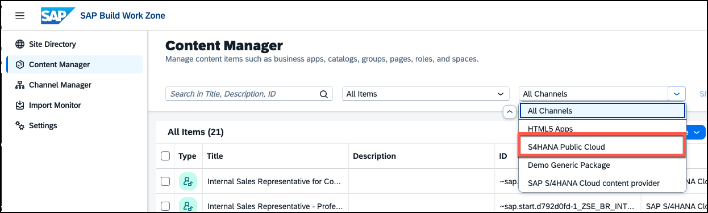

   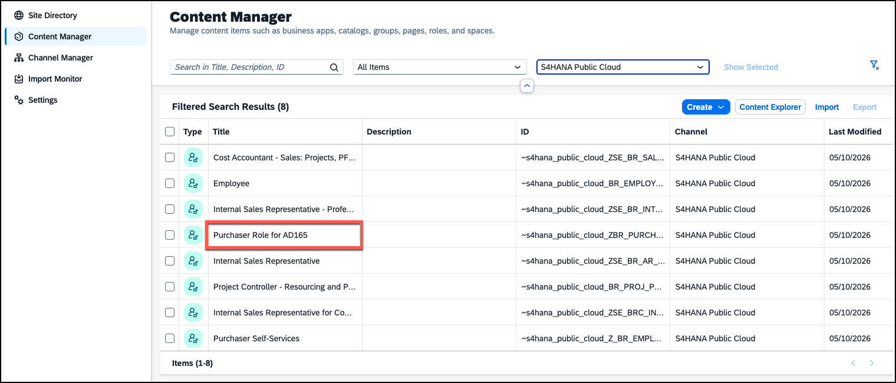

3. **Inspect a Purchasing role** — locate one of the Purchasing roles (e.g. **Purchaser Role for AD165**) and click on it to open the role details.

4. **Review the assigned content** — in the role editor, check the **Apps** and **Spaces** tabs to see which apps and spaces are included in this role. You can also click an app in the list to view more details. Note that these items are read-only — federated content can only be modified in the originating backend system.

   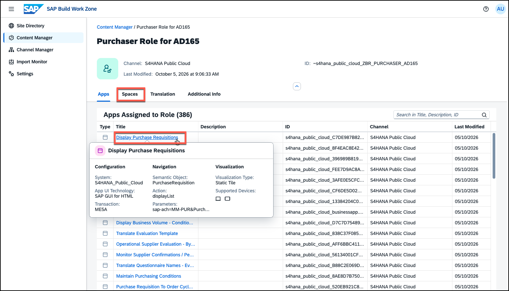

   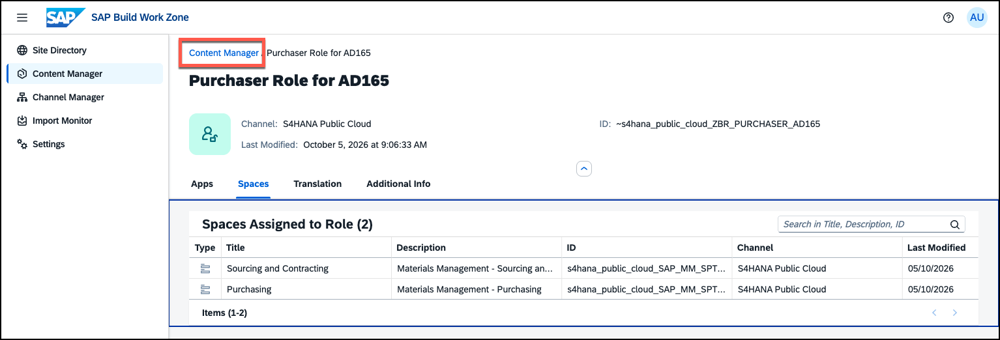

5. **Navigate back** — click **Content Manager** in the breadcrumb to return to the content list. You could also go directly from here to the Site Directory where you will assign some of the federated roles to your site to make its content available there.

> [!NOTE]
> Content items that come from a backend channel are marked with the provider name. They cannot be edited in Work Zone — any changes to roles, apps, or spaces must be made in the SAP S/4HANA system and then re-exposed via the channel.

---

##  Exercise 2.4 - Assign a Content Channel or Single Roles to Your Site

### What you'll achieve
After completing these steps, selected business content from a backend system will be assigned to your Work Zone site, making the corresponding apps available to users with the right role.

---

You have two options: assign individual roles for fine-grained control, or assign the full content channel which requires less manual effort and automatically reflects any future changes to the channel.

> [!TIP]
> Assigning the full content channel also enables **Automatic Updates**. Every time the S/4HANA system pushes updated content, the Channel Manager is notified and the channel content is refreshed automatically. Scheduling regular exposure runs on the SAP S/4HANA side is required for full automation — this configuration is not covered in this exercise.

---

### Steps

1. **Open your site settings**: navigate to **Site Directory** and open the settings of your site by clicking the cog icon again.

   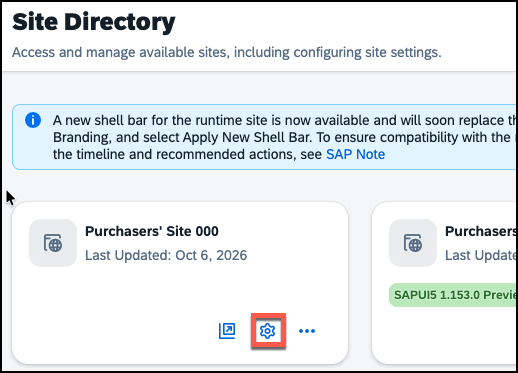

   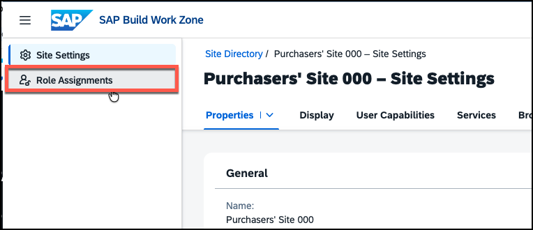

2. **Open the Content Channels tab**: go to the **Role Assignments** section and open the **Content Channels** tab.

3. **Assign the S/4HANA channel**: First, click the **Edit** button to switch to edit mode. Then move the switch for the **S4HANA Public Cloud** channel to **On**.

   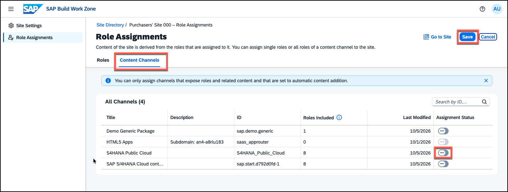

> [!TIP]
> Navigate back to the **Roles** tab — all roles from the S4HANA Public Cloud channel now show up as selected. They can only be deselected via the Content Channels tab. Feel free to assign only specific roles instead. If you do so, make sure that **Employee**, **Purchaser Role for AD165**, **Project Controller**, and **Purchaser Self-Services** are selected. Also make sure to use the roles with IDs starting with *~s4hana_public_cloud_*, because they come from the right content provider. The second SAP S/4HANA content provider was created specifically for making S/4HANA content available for SAP Joule and has some different connectivity settings.

4. **Save your changes** — click Save and confirm the *Information* pop-up with **OK**.

   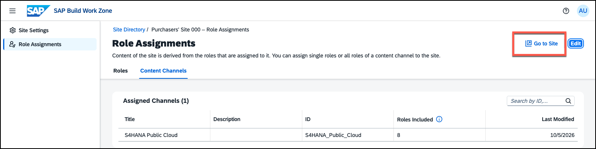

---

##  Exercise 2.5 - Open Your Site in Runtime

### What you'll achieve
After completing these steps you will have explored the Work Zone standard runtime experience with federated S/4HANA content.

---

### Steps

1. **Open the site**: on top of the page, click **Go to Site** to open your site in runtime. The site opens in a new tab.

2. **Check the custom logo** — notice the logo you added in Exercise 1.4 displayed in the shell bar.

   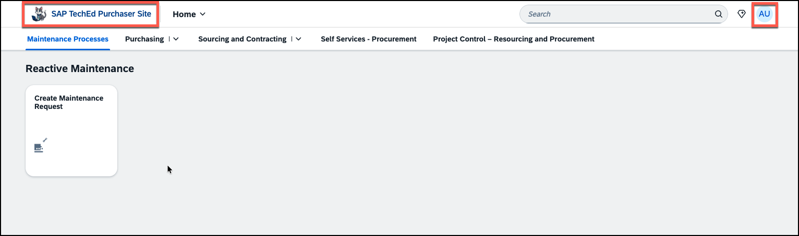

3. **Explore User Settings** — click the user icon in the shell bar to open **User Settings** and navigate to **Settings**. 

   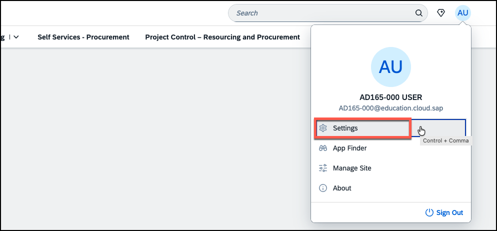

In the **Language and Region** area, users can select their preferred language from the list you configured in Exercise 1.3. Adjust the language if you like, then close the settings by clicking **Save** or **Cancel**. 

> [!NOTE]
> We recommend that you switch back to English afterwards if you would like to check the site in a different language. This will make it easier to follow the steps in the exercise.

   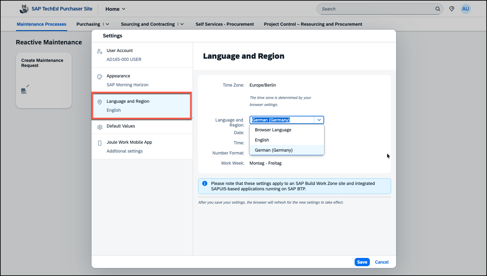

4. **Browse the federated spaces** — in the top navigation menu, all entries come from spaces that belong to the S/4HANA roles you assigned to your site in Exercise 2.4. Click the little arrow next to some of them to see the pages assigned to this space.

   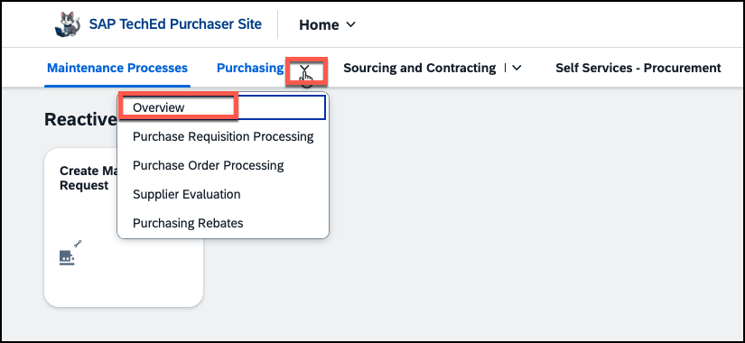

> [!NOTE]
> You only see these spaces because the corresponding roles have been assigned to your user upfront. There are two prerequisites for content to become available to a specific user in a site:
> 1. The content needs to be assigned to a role that is assigned to the user.
> 2. The content needs to be assigned to a role that is assigned to the site.

5. **Launch an app** — navigate to the **Overview** page in the **Purchasing** space and click on **Monitor Purchase Order Items**. It opens in a new browser tab — this behavior is defined by the content exposure in the S/4HANA system.

   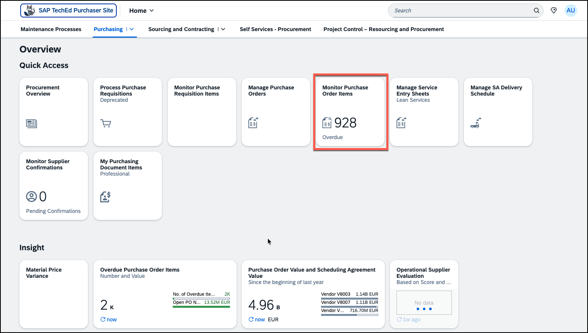

6. **Display data** — in the app, select **EUR** as the *Display Currency** because this is a mandatory field. You can simply type EUR into the entry field or use the value help. Then click **Go** to see the list of open purchase order items.

   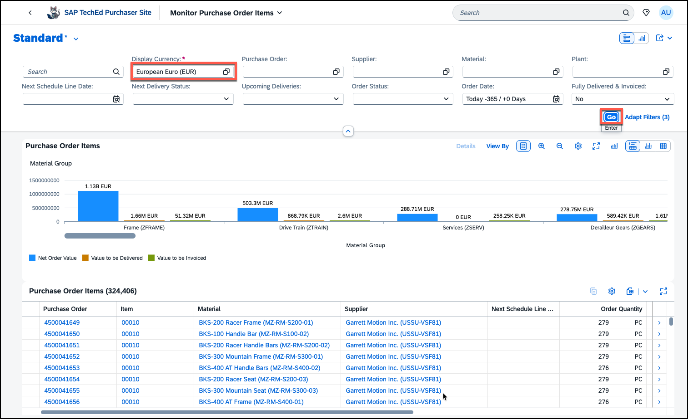

7. **Navigate back** — close the browser tab to return to your Work Zone site.

---

## Summary

You explored the admin environment of SAP Build Work Zone, standard edition. You connected your Work Zone instance to business content from an S/4HANA system using the Channel Manager, explored the federated content in the Content Manager, assigned a content channel and roles to your site, and saw the federated apps appear in runtime.

Continue to - [Exercise 3 - Create a Work Zone Page and Space](../ex3/README.md)
