# Exercise 3 - Create a Work Zone Page and Space

In this exercise, you will create a custom page and organize it in a space to make it visible in the site navigation, then assign it to a role so the right users can access it. You will create an entry page for employees with some self services and some purchaser specific cards.

> [!NOTE]
> In SAP Build Work Zone sites, **spaces** provide the top-level navigation structure, and **pages** contain the actual content — cards and apps. A space can group multiple related pages together. Spaces and pages are assigned to roles, which controls who can see them.

---

## Exercise 3.1 - Create a New Page

### What you'll achieve
By completing these steps, you've built a Work Zone page that brings employee self-service apps and purchasing cards together in one place. This is the same approach you'd use to consolidate content from multiple sources — different backend systems, custom apps deployed on SAP BTP, or any combination of both. The cards surface key information directly on the page, so users get what they need at a glance — without having to navigate somewhere else first.

---

### Steps

1. **Navigate to Content Manager** — go back to the browser tab with your Work Zone administration environment. If you are still on the *Role Assignments* tab, first navigate back to the *Site Directory* via the breadcrumb to see the left-hand menu. Then click **Content Manager**.

   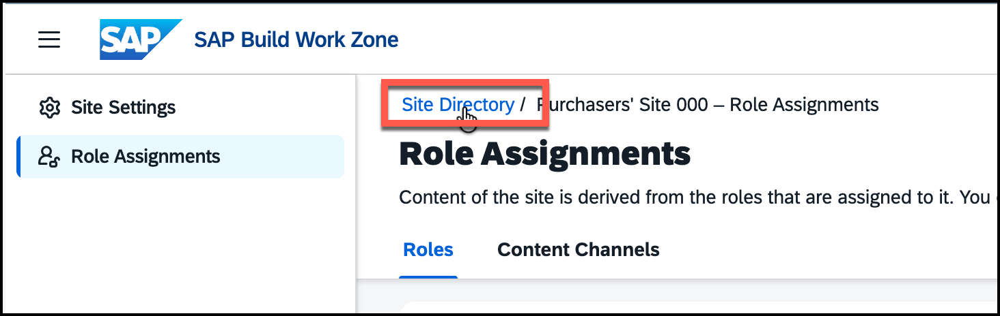

2. **Create a new page** — in the Content Manager, click **Create** and select **Page**. The page editor opens.

   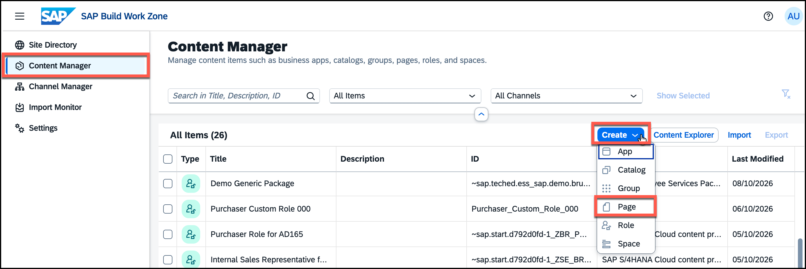

3. **Enter a title** — enter a meaningful title (e.g. **Welcome**), and enter your participant number as description, so you will be able to find your page easily later. If you want, you can also add a longer description. The title will become visible on top of the new page and in the menu, in case there is more than one page assigned to the respective page.

   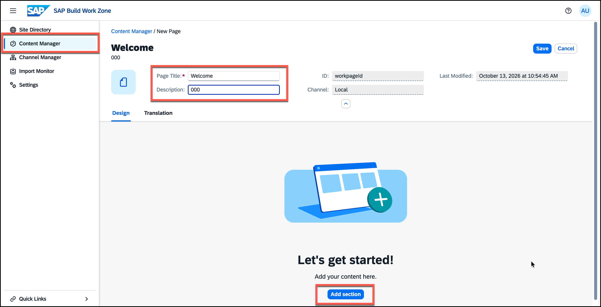

4. **Add a first section** — click **Add Section** and enter the header **Purchasing Insights**.

   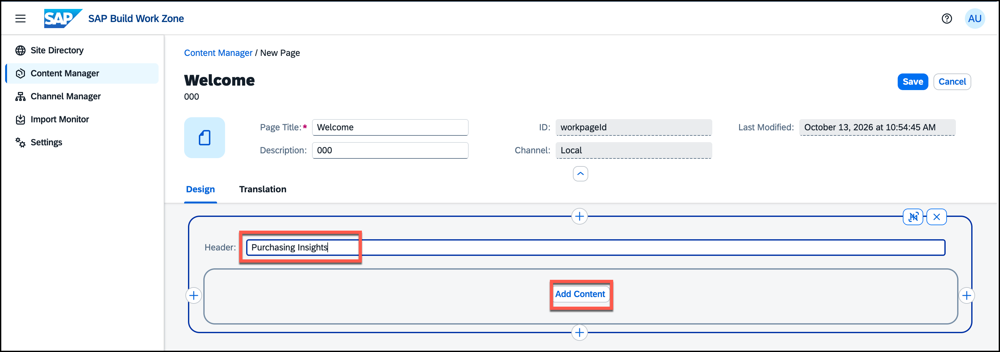

5. **Find cards and tiles** — click **Add Content** in the section. This opens the **App Finder** which allows you to add both tiles and cards to your page.

6. **Add cards** — move the switch on top of the App Finder to **Cards** and click the card **Unacknowledged POs** to add it. You get back to the page view and see the card in a preview display without data.

   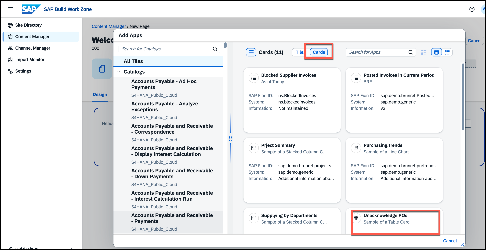

   To add another card, click the **+** sign right of your card to add a new column and do the same steps to add the **Posted Invoice in Current Period** card in addition. Do not forget to switch to **Cards** in the *App Finder*.

   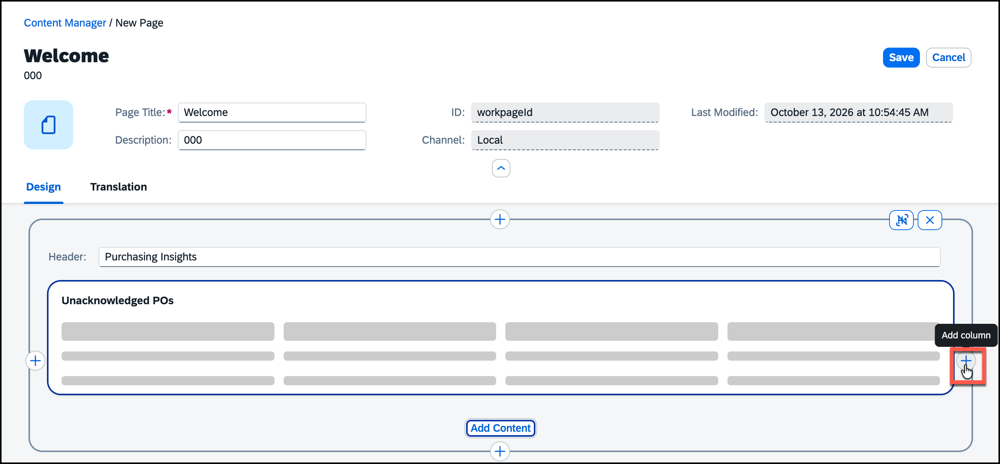

   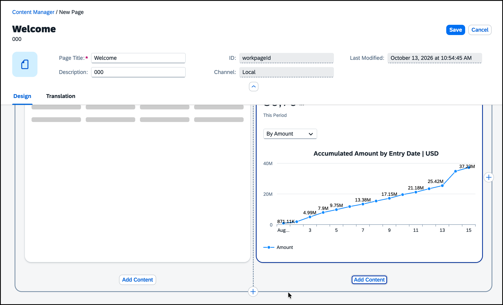

7. **Add a second section** — add a new section by clicking the **+** sign below the current section, leave the header empty and add the cards **Purchasing Trends** and **Supplying by Departments**.

   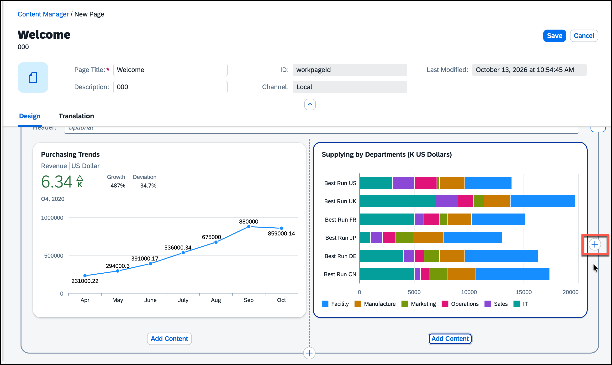

8. **Add another cell for tiles** — click the **+** sign to the right of the *Supplying by Departments* card again. This time, you will add some dynamic tiles. Use the search to add the tiles for the following apps **Operational Supplier Evaluation**, **Off-Contract Spend**, and **Overdue Purchase Order Items**. You can find them and click their checkbox one by one. After selecting all tiles, click the **Add(3)** button in the lower right corner.

   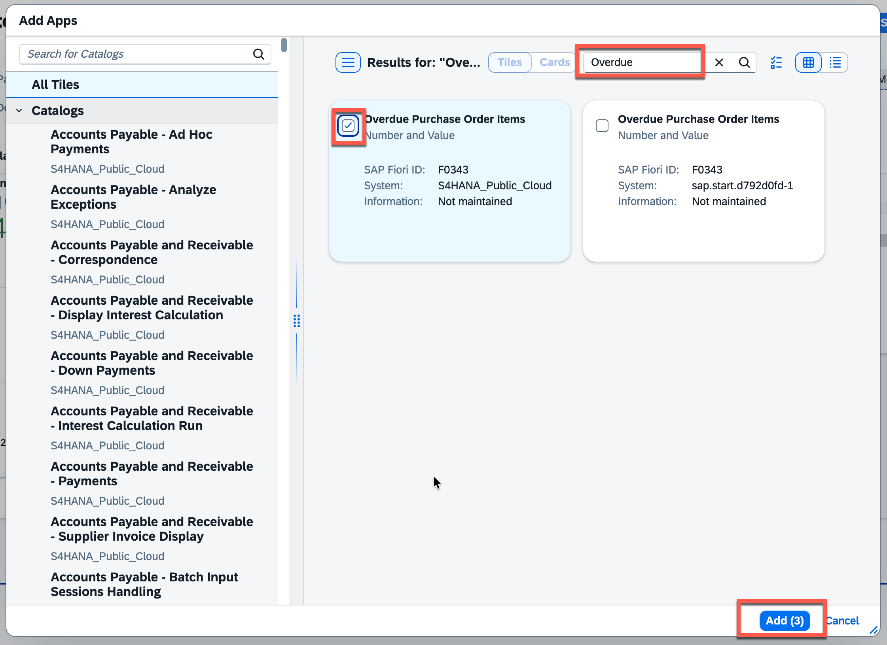

9. **Save your page.**

   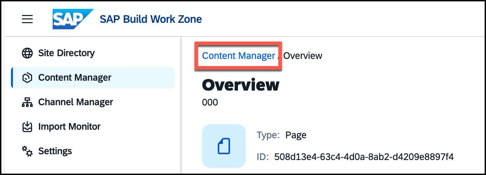

> [!TIP]
> If you still have time at the end of the session, you can add your own UI integration card to this page in Exercise 8 (Optional).

---

## Exercise 3.2 - Create a Space and Assign the Page

### What you'll achieve
After completing these steps your page will be organized inside a space that can be surfaced in the site navigation.

---

### Steps

1. **Create a new space** — use the breadcrumb to navigate back to the Content Manager, click **Create** and select **Space**.

   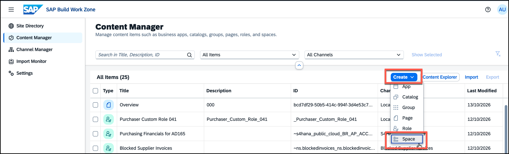

2. **Enter a title** — give the space a title (e.g. **Get Started**) and add your participant number to the **Description** to allow you to find the space easily. The title will be displayed in the menu of the site.

> [!TIP]
> You can enter a Sort Priority which determines in which position the space will be displayed. You can keep the default value 0.0 to display your space to the left of the federated spaces. SAP S/4HANA spaces created from SAP delivered space templates have positive sort priority values if not customized differently.

3. **Assign the page** — in the lower part of the screen, you see the available **Pages**. Identify the page you created in Exercise 3.1 (search for your participant number ### if needed) and turn the switch for your page to **On** in the *Assignment Status* column.

4. **Save the space.**

   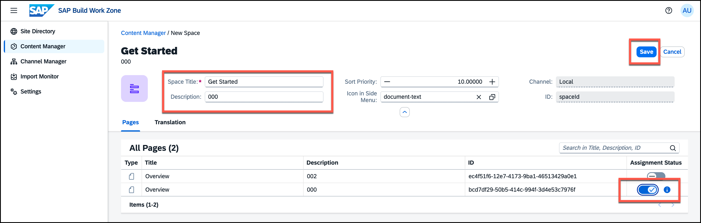

---

## Exercise 3.3 - Add the Space to a Pre-Configured Custom Role

### What you'll achieve
After completing these steps the space will be visible to users who have the custom role assigned, making it accessible when they open your site.

---

Because you do not have access to the BTP cockpit in this workshop, a custom role has been preconfigured for you and already assigned to your user.

---

### Steps

1. **Navigate to Content Manager** — go back to the Content Manager using the breadcrumb.

2. **Open the custom role** — find the pre-configured custom role that has been created for your user and click it. The role is called **Purchaser Custom Role + \<your participant number\>**. You can search for your participant number, or use the **All Items** filter to restrict the list to roles only.

   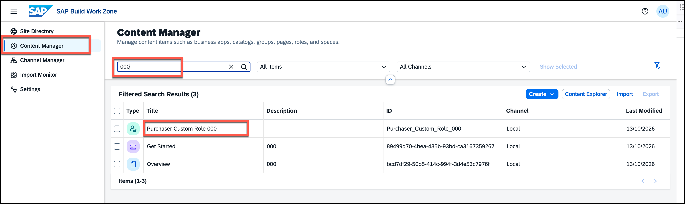

3. **Switch to Edit Mode** — click the **Edit** button.

   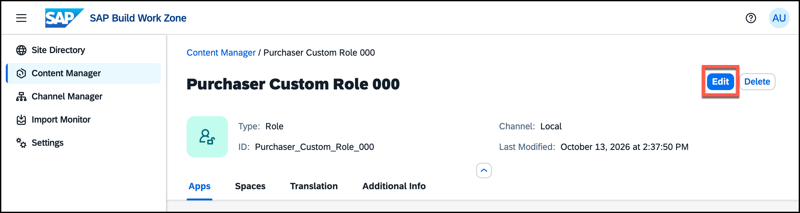

4. **Assign the space** — go to the **Spaces** tab and assign the space you created in Exercise 3.2 by turning its switch to **On** in the *Assignment Status* column.

5. **Save the role.**

   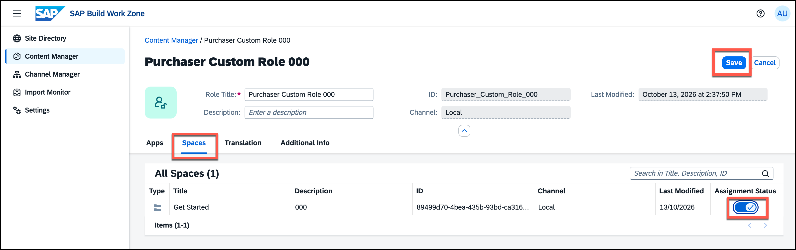

---

## Exercise 3.4 - Assign the Custom Role to Your Site

### What you'll achieve
After completing these steps the custom role will be assigned to your site, making the space visible to users who have that role.

---

For content to appear in the site, the role it is assigned to must also be assigned to the site itself. You do this in the Site Settings.

### Steps

1. **Open the site settings** — navigate to **Site Directory** and open the settings of your site.

   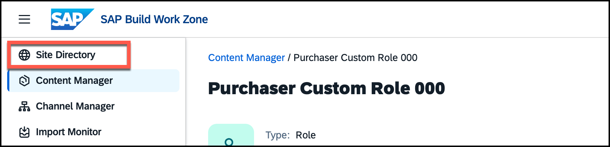

   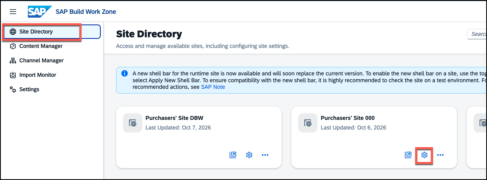

2. **Open the Role Assignments section** — go to the **Role Assignments** section and make sure you are on the **Roles** tab. You see a long list of roles assigned to your site. 

3. **Switch to Edit mode** — click the **Edit** button.

   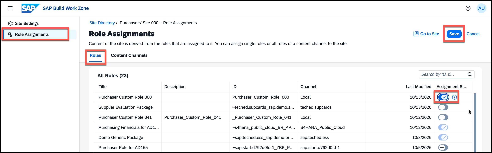

4. **Assign the custom role** — enter your *participant number* into the search field to find the **Purchaser Custom Role + \<your participant number\>** and turn its switch to **On** in the *Assignment Status* column.

5. **Save your changes.**

   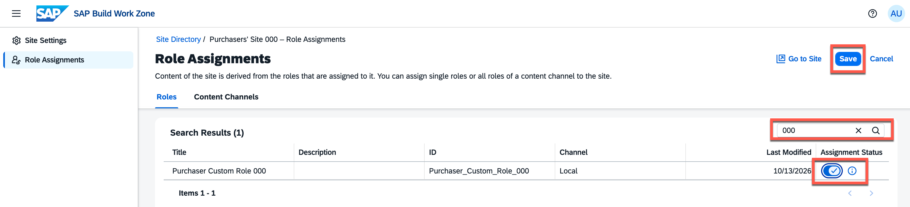

6. **Verify in the site** — click **Go to Site** on your site and confirm that the new space appears in the site navigation. Since the space is the first one in the menu, you immediately see the page you created.

   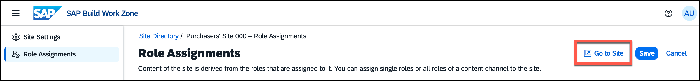

   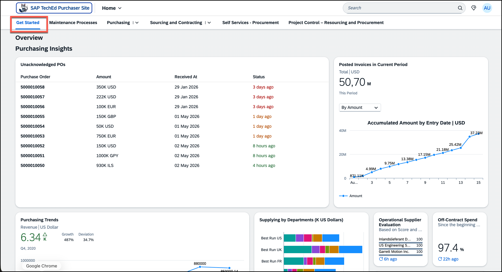

---

## Summary

You created a page, organized it in a space, assigned the space to a role, and assigned that role to your site so it appears in the site navigation for the right users.

Continue to - [Exercise 4 - Enable My Space](../ex4/README.md)
