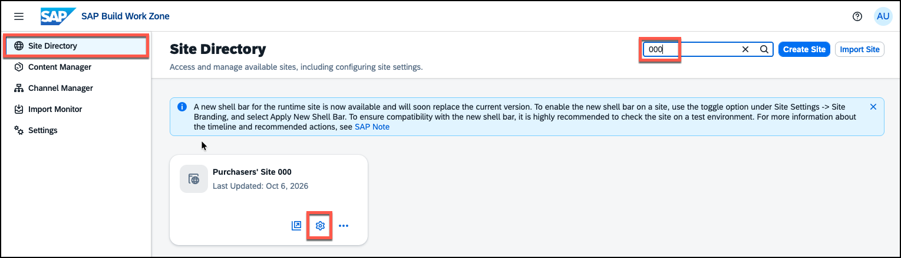
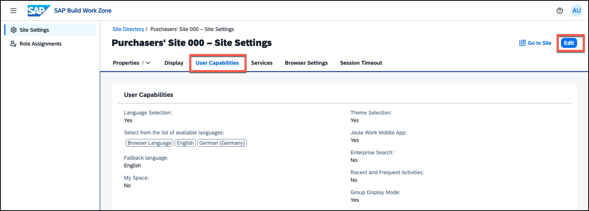
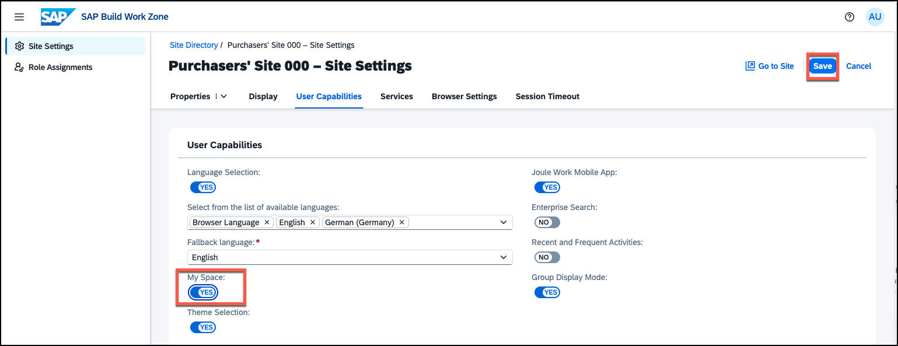

# Exercise 4 - Enable My Space

In this exercise, you will enable the **My Space** feature for your site. My Space is a personal, user-owned landing page that every user can customize independently — adding cards and apps that are most relevant to their daily work. Once enabled by an administrator, users can build and maintain their own page directly in the site.

> [!NOTE]
> My Space is a key productivity feature in SAP Build Work Zone that empowers end users to create a personalized entry point tailored to their own needs. Unlike other spaces and pages in the menu, which are shared and cannot be modified by individual users, My Space is private and individual. Users can add any cards they have access to, choose their layout, and rearrange content at any time. While shared spaces ensure everyone gets the right role-based content, My Space removes the remaining friction that is individual — the specific items each person checks first every morning.

---

## Exercise 4.1 - Enable My Space for Your Site

### What you'll achieve
After completing these steps My Space will be available to all users of your site.

---

### Steps

1. **Open your site settings** — Go back to the tab with the *Work Zone administration environment* and navigate to **Site Directory**. Then open the settings of your site.

   

> [!TIP]
> If you do not see the site directly in the Site Directory, you can search for your participant ID. 

2. **Navigate to User Capabilities** — go to the **User Capabilities** tab in the site settings.

3. **Switch to Edit Mode** — click the **Edit** button in the upper right corner.

   

4. **Enable My Space** — locate the **My Space** setting and toggle it to **On**.

5. **Save your changes.**

   

> [!TIP]
> Once My Space is enabled, users will find a dedicated **My Space** entry in their User settings. In the next exercise, you will learn how to enable and use My Spaces as a user. 

---

## Summary

You have enabled My Space for your Work Zone site. End users can now create and maintain their own personal page within the site.

Continue to - [Exercise 5 - Explore the Site as an End User](../ex5/README.md)
