# Exercise 5 - Explore the Site as an End User

In this exercise, you switch from the administrator role to the end-user role and experience the site you have built. You will explore what the AI assistant Joule can do for you, then navigate to My Space and start building your own personal page using the cards available to you.

---

##  Exercise 5.1 - Explore What Joule Can Do for You

### What you'll achieve
After completing these steps you will have discovered some key capabilities of Joule as an end user working within Work Zone.

---

> [!NOTE]
> Joule's capabilities depend on the content and integrations configured for your site. In this exercise environment, certain integrations are pre-configured to show meaningful responses. In a production system, the full scope of Joule depends on the connected SAP applications and services.

---

### Scenario: Investigating a Supplier Invoice

A supplier contacts you requesting an update on some invoices. As a Procurement Manager, you need to review the invoice details and check other invoices associated with specific purchase order.

Instead of navigating through multiple applications, you use **Joule** to quickly retrieve the relevant information from SAP S/4HANA.

### Steps

1. **Open your site** — Click **Go to Site** again to navigate to your site.

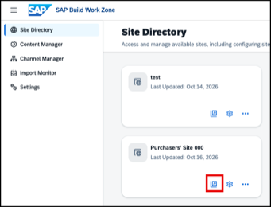

2. **Open Joule** — locate the **Joule** icon in the shell bar and click it to open the Joule panel.
   
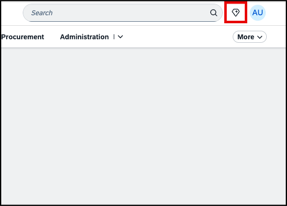 

3. Enter the following prompt:

   **Prompt:** Can you look for details for supplier invoice 5107253170? 

   Select the following **option:** Display Invoice Details

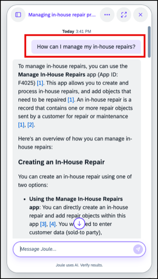 

4. When asked for the fiscal year, provide this **answer:** 2026

   Browse through the Invoice details. 

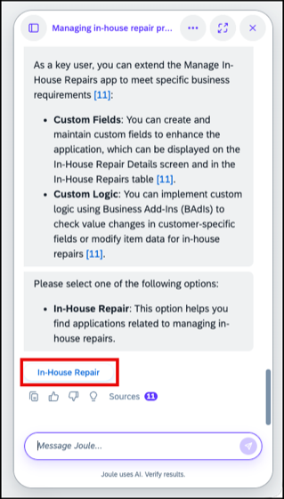

5. Next, give Joule the following prompt:

   **Prompt:** Show me all invoices for PO 4500029946?

   Click on **Open** to get more details. 

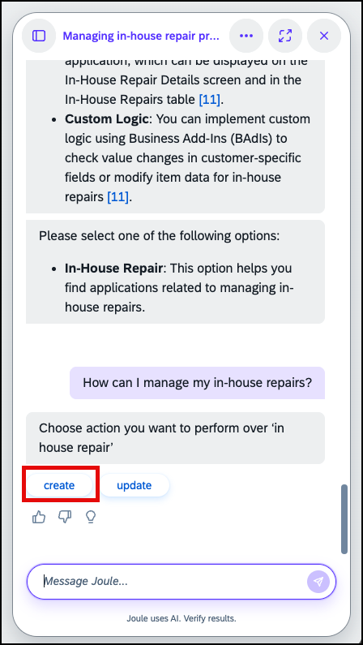   

6. The application will open in a new tab, browse through the full details. 

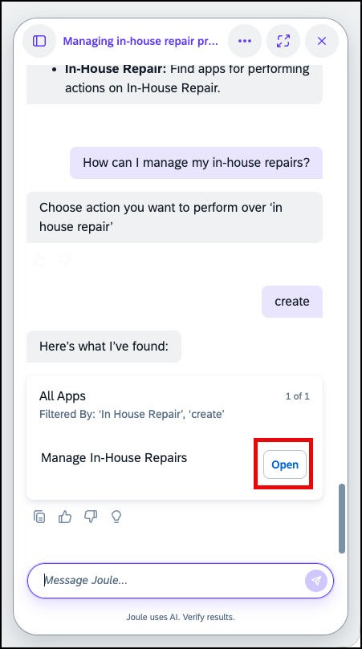  

7. Close the tab now. 

---

##  Exercise 5.2 - Enable My Space

### What you'll achieve
After completing these steps My Space will be visible in the site navigation and ready for you to personalise.

---

My Space is a personal page that each user can configure independently — adding the cards and tiles most relevant to their daily work. Before it appears in the navigation, each user must enable it once in their personal settings.

### Steps

1. **Open User Settings** — click the **User Icon** in the shell bar, then select **Settings**. Notice that there is now a new entry for enabling or disabling the personalization with My Space.

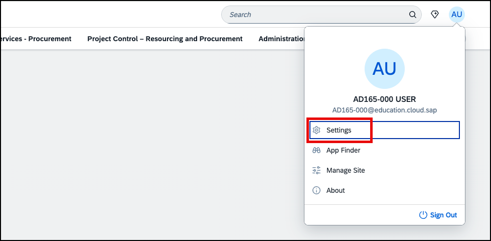

2. **Go to the My Space tab** — in the Settings dialog, open the **My Space** tab.

3. **Enable My Space** — select the checkbox **Show My Space** and click **Save**.

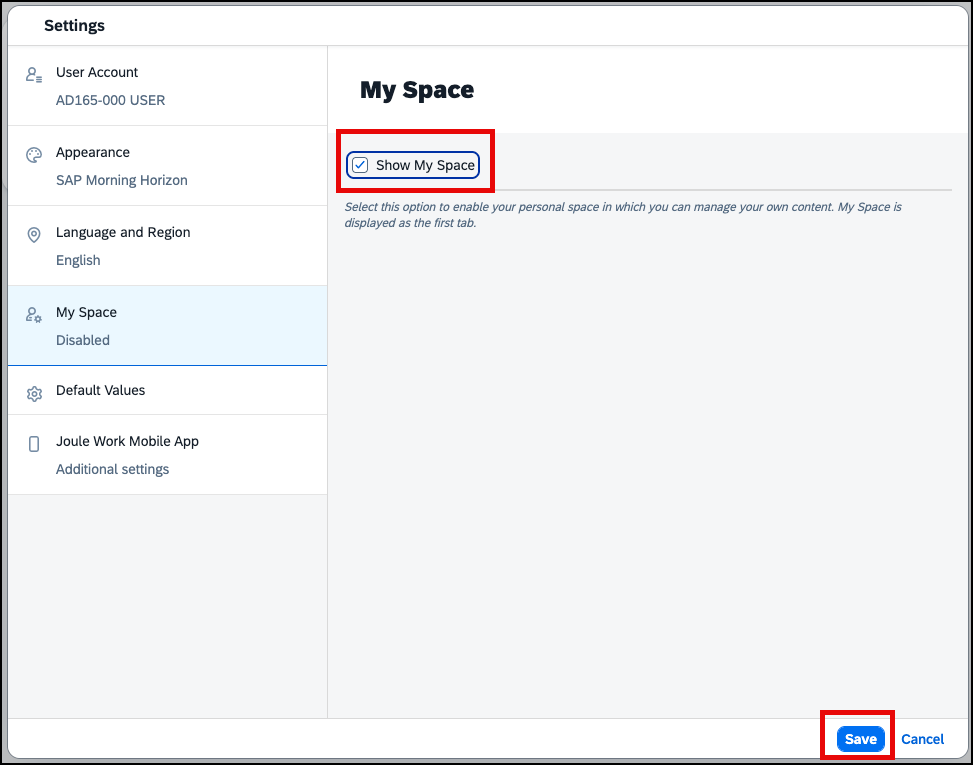

4. **See it in the menu** — Work Zone refreshes and takes you directly to the new **My Space** tab that now appears as the first entry in the navigation menu.

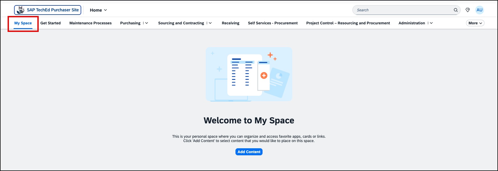

---

##  Exercise 5.3 - Start Building Your Personal Page

### What you'll achieve
After completing these steps you will have created your own personal page using cards and tiles in My Space.

---

Think of this as building a personal productivity cockpit: the items you add here are the ones you'd otherwise open several apps or tabs to check every day.

### Steps

1. **Start building** — your My Space page is initially empty, but it is already in editing mode. Click **Add Content** to start adding tiles or cards.

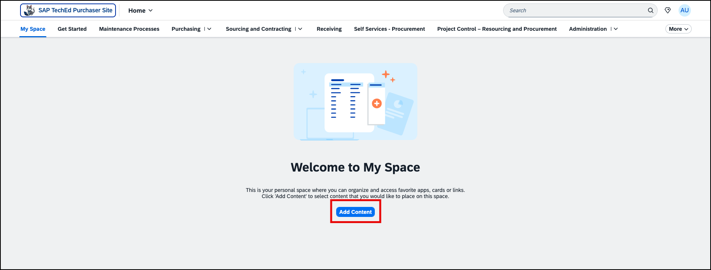

---

> [!NOTE]
> If you want to return to editing My Space at a later point in time after saving it, you can always switch to Edit mode via the `User Menu. 
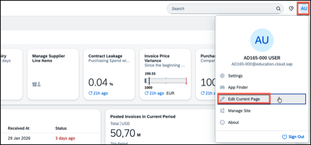

---

2. **Add further sections or cells** — click the **+** sign at the bottom of the current sections to add further sections below or hover the section to see further **+** signs to the left and right to add more columns.

3. **Add a section title** — click into the entry field next to *Header* to add a title to your section.

4. **Remove a column or section** — you can always delete columns or sections by clicking the cross icon that appears when hovering them.

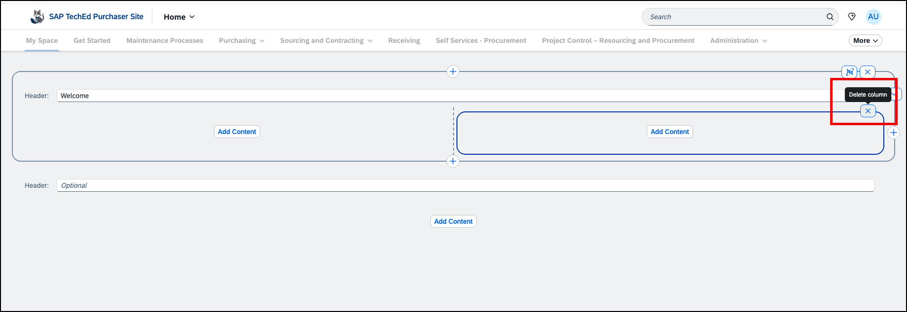

5. **Add content** — click **Add Content** and explore the available cards and tiles. Add at least one card and one tile to your page.

6. **Rearrange the content** — drag and drop items into the position you prefer.

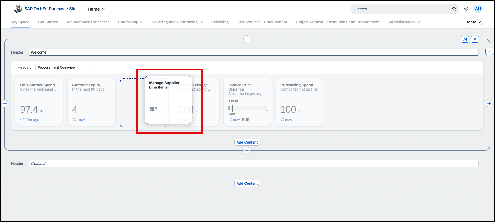

7. **Save your page**. You automatically exit edit mode when saving. You can switch back to it by selecting **Edit Current Page** from the User Menu.

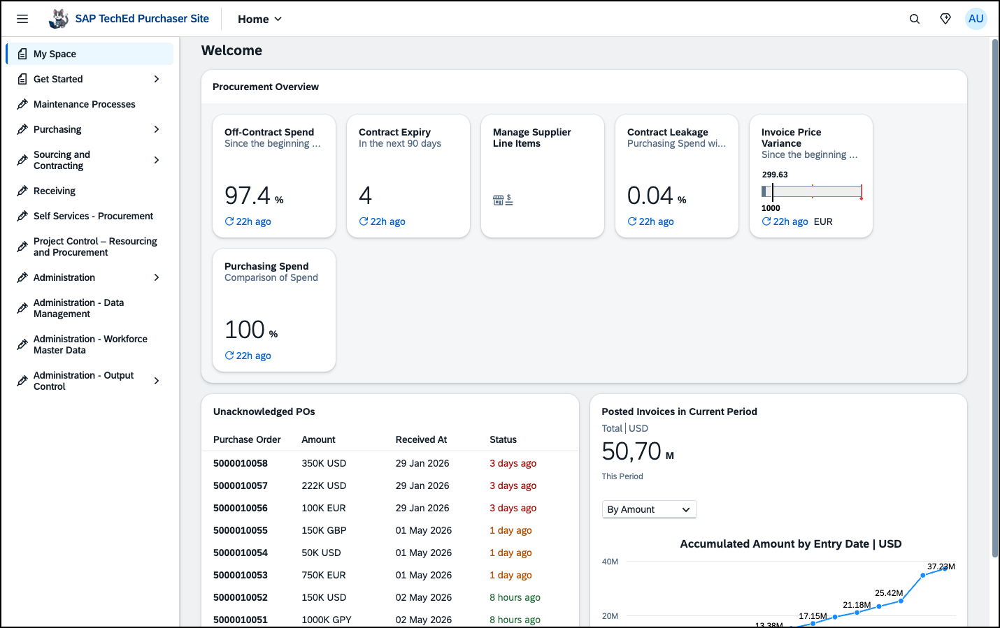

---

## Summary

You have built a Work Zone site from scratch, connected business content, created pages and spaces, enabled My Space, and experienced the full end-user journey including Joule and personal page building. **Congratulations — you have completed all the core exercises of this session!**

There are three optional exercises available. Choose one or more depending on the time you have left:

- [Exercise 6 (Optional) - Access the Site on the Joule Work Mobile App](../ex6/README.md) *(approx. 10 min)* — install the SAP Joule Work app on your phone and register it to your site. Ideal if you have a mobile device with you.
- [Exercise 7 (Optional) - Change the Site Navigation to Side Menu](../ex7/README.md) *(approx. 5 min)* — switch the site navigation from top bar to side panel and update your space icon. A quick win if you are short on time.
- [Exercise 8 (Optional) - Create, Package, and Deploy Your Own UI Integration Card](../ex8/README.md) *(approx. 25-30 min)* — build a UI integration card in the Card Explorer, package it using SAP Business Application Studio, and deploy it to your Work Zone page. The most technical and hands-on of the three.
