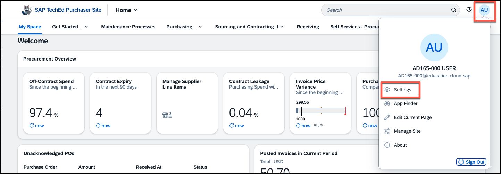
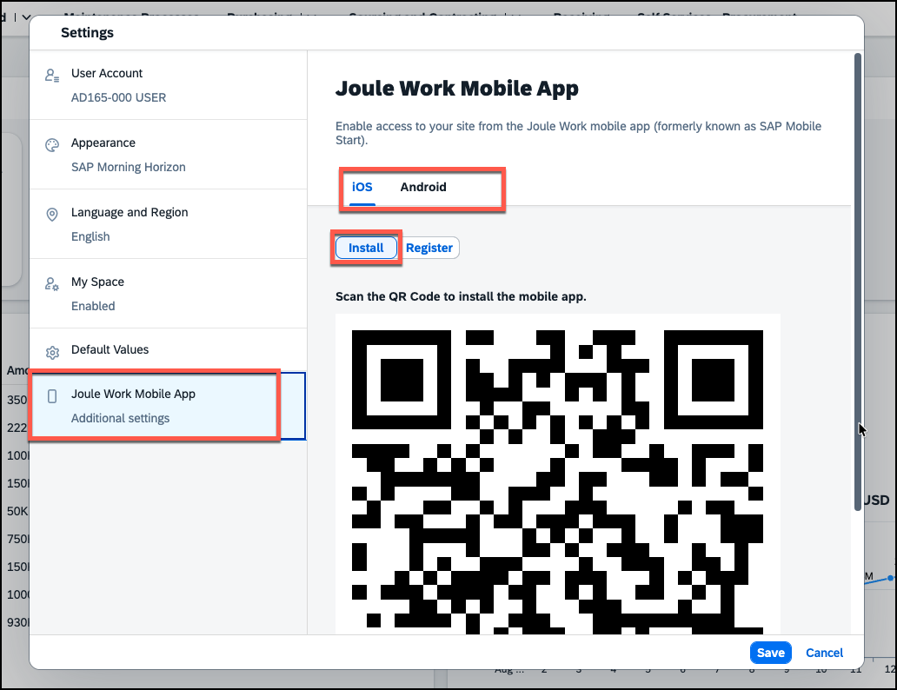

# Exercise 6 (Optional) - Access the Site on the Joule Work Mobile App

In this exercise, you will first enable the Joule Work Mobile App feature for your site as an administrator, and then access your Work Zone site from a mobile device using the SAP Joule Work app.

> [!NOTE]
> The SAP Joule Work mobile app gives users native access to their Work Zone sites and business applications on iOS and Android devices. They can interact with Joule, access their spaces and pages, and manage their tasks — all from their phone. For productivity, this means approvals, task checks, and Joule interactions are no longer tied to a desk.

---

##  Exercise 6.1 - Enable the Joule Work Mobile App for Your Site

### What you'll achieve
After completing these steps, you will ahve confirmed that the Joule Work Mobile App feature is active for your site, allowing users to connect to it from their mobile device.

---

### Steps

1. **Open your site settings** — navigate back to the browser tab with the Admin environment open. If necessary, go to **Site Directory** and open the settings of your site.

2. **Navigate to User Capabilities** — go to the **User Capabilities** tab in the site settings.

3. **Check the Joule Work Mobile App setting** — locate the **Joule Work Mobile App** checkbox and make sure it is selected. This is the default setting for new sites. Otherwise, turn it on now. 

---

##  Exercise 6.2 - Access Your Site on the Mobile App

### What you'll achieve
After completing these steps you will have installed the SAP Joule Work app on your mobile device and registered it to your Work Zone site.

---

### Steps

1. **Open the User settings in your site** — navigate to your site by clicking **Go to site**. In the site, click the **User Icon** in the shell bar, then select **Settings**.

   

2. **Open the Joule Work Mobile App tab** — in the Settings dialog, find and open the **Joule Work Mobile App** tab.

3. **Select your operating system** — choose either **iOS** or **Android** depending on your device.

   

4. **Install the app** — if you do not have the app installed on your device yet, use the QR code to open the App Store (iOS) or Play Store (Android) and install the **SAP Joule Work** app on your device.

5. **Register to the site** — once the app is installed, go back to the desktop and switch to **Register** in the *Joule Work Mobile App* settings to scan a second QR code to register your device to this Work Zone site.

   

6. **Enter your credentials** — on your mobile device, use the switch enter the same user credentials you used to log in to the workshop environment.

7. **Explore the app** — once logged in, explore the home screen and the four main tabs:
   - **Home** — your personal start page with quick access to Joule and your to-dos and favorites
   - **Joule** — a dedicated tab for interacting with the AI assistant
   - **Apps** — all the spaces and pages you know from the desktop experience
   - **To Do** — your Task Center items

---

## Summary

You have enabled the Joule Work Mobile App for your site and accessed it from a mobile device. You can now work with Joule, browse your spaces and pages, and manage tasks on the go.

If you want, continue now to - [Exercise 7 (Optional) - Change the Site Navigation to Side Menu](../ex7/README.md)

Thank you for participating in **AD165 - Boost user productivity with AI assistant Joule and personal My Space for SAP Build Work Zone**.
