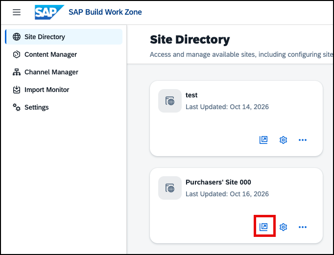
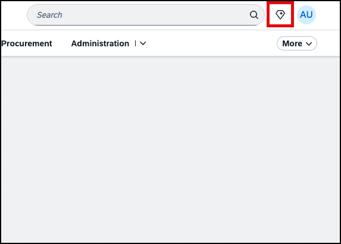
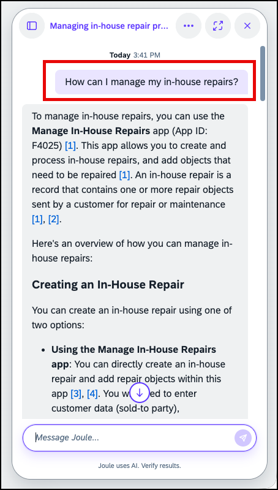
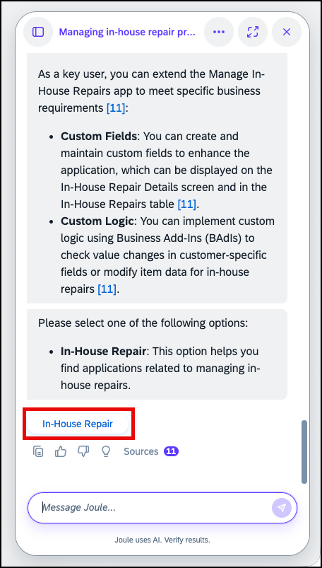
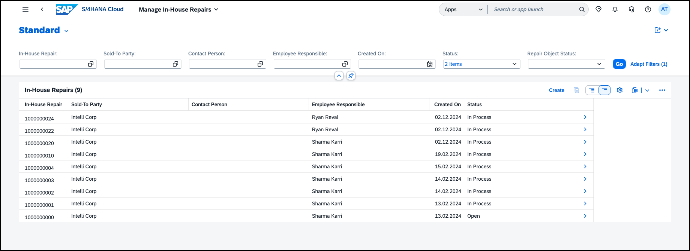
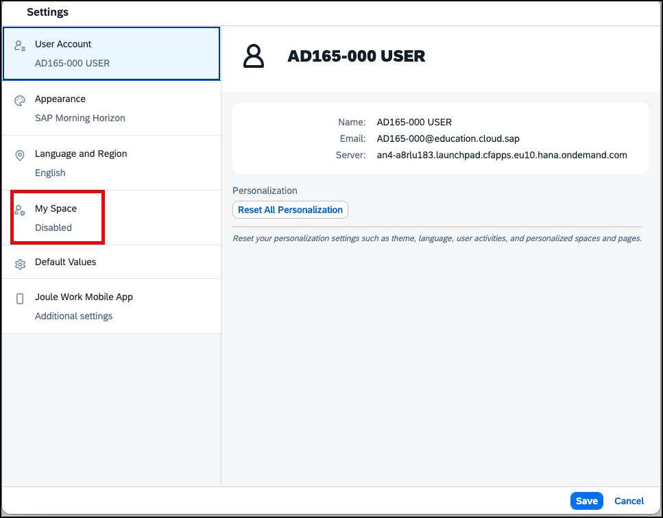
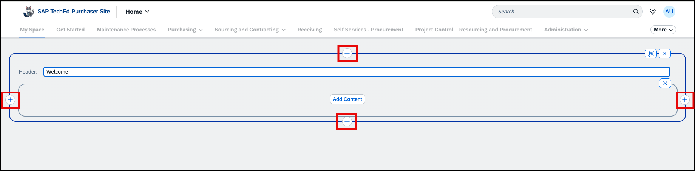
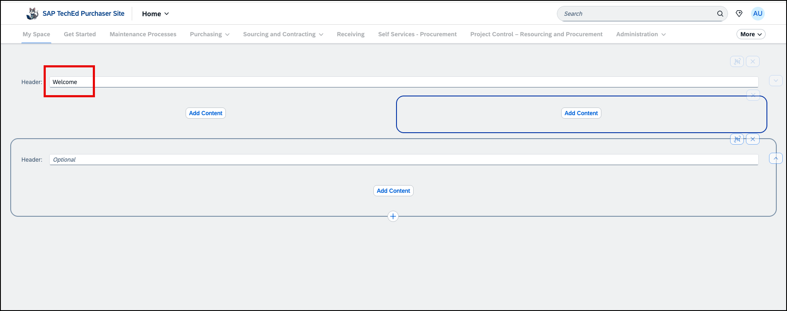
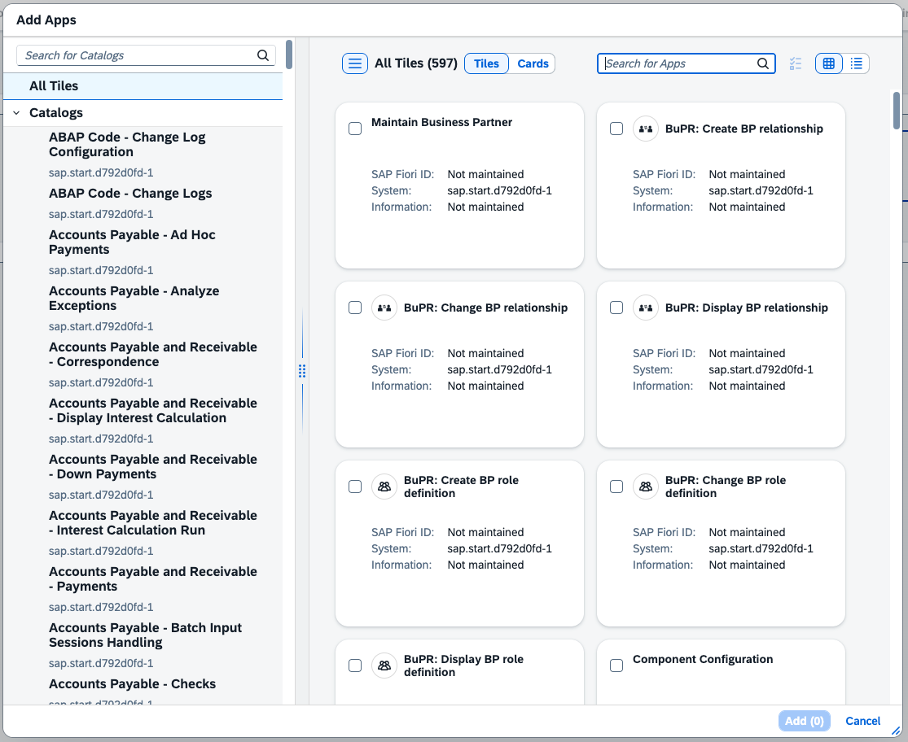
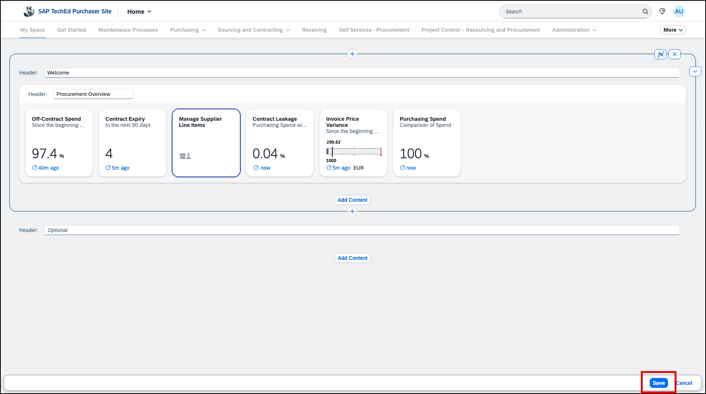

# Exercise 6 - Explore the Site as an End User

In this exercise, you switch from the administrator role to the end-user role and experience the site you have built. You will explore what the AI assistant Joule can do for you, then navigate to My Space and start building your own personal page using the cards and widgets available to you.

---

##  Exercise 6.1 - Explore What Joule Can Do for You

### What you'll achieve
After completing these steps you will have discovered some key capabilities of Joule as an end user working within Work Zone.

---

> [!NOTE]
> Joule's capabilities depend on the content and integrations configured for your site. In this exercise environment, certain integrations are pre-configured to show meaningful responses. In a production system, the full scope of Joule depends on the connected SAP applications and services.

---

### Scenario: Managing In-House Repairs

As a purchaser, you are responsible for managing procurement activities and supporting maintenance processes. A colleague has reported an equipment issue that requires an in-house repair. You now want to find the right application to create a repair request and track existing repairs.

Let's ask **Joule** to help with this scenario.
  

### Steps

1. **Open your site** — Click **Go to Site** again to navigate to your site.

2. **Open Joule** — locate the **Joule** icon in the shell bar and click it to open the Joule panel.
   
 

3. Enter the following prompt:

   **Prompt:** `How can I manage my in-house repairs?`

   Review the summary provided by Joule about managing in-house repairs.

 

4. In the Joule response, click the suggested: **In-House Repair**

5. Joule will display several options. Click **Create** to proceed.

   

6. Click **Open** to open the application.

  

7. The application will open in a new tab, browse the list of existing in-house repairs.

   

8. Close the tab now. 

---

##  Exercise 6.2 - Enable My Space

### What you'll achieve
After completing these steps My Space will be visible in the site navigation and ready for you to personalise.

---

My Space is a personal page that each user can configure independently — adding the cards, tiles, and widgets most relevant to their daily work. Before it appears in the navigation, each user must enable it once in their personal settings.

> [!NOTE]
> Right now, My Space always appears as the first entry in the navigation menu. Support for administrators to define its position via Site Settings is planned for a future release.

### Steps

1. **Open User Settings** — click the **User Icon** in the shell bar, then select **Settings**. Notice that there is now a new entry for enabling or disabling the personalization with My Space.

2. **Go to the My Space tab** — in the Settings dialog, open the **My Space** tab.

3. **Enable My Space** — select the checkbox **Show My Space** and click **Save**.

4. **See it in the menu** — Work Zone refreshes and takes you directly to the new **My Space** tab that now appears as the first entry in the navigation menu.

---

##  Exercise 6.3 - Start Building Your Personal Page

### What you'll achieve
After completing these steps you will have created your own personal page using cards and tiles in My Space.

---

Think of this as building a personal productivity cockpit: the items you add here are the ones you'd otherwise open several apps or tabs to check every day.

### Steps

1. **Start building** — your My Space page is initially empty, but it is already in editing mode. Click **Add Content** to start adding tiles or cards.

2. **Add further sections or cells** — click the **+** sign at the bottom of the current sections to add further sections below or hover the section to see further **+** signs to the left and right to add more columns.

3. **Add a section title** — click into the entry field next to *Header* to add a title to your section.

4. **Remove a column or section** — you can always delete columns or sections by clicking the cross icon that appears when hovering them.

5. **Add content** — click **Add Content** and explore the available cards and tiles. Add at least one card and one tile to your page.

6. **Rearrange the content** — drag and drop items into the position you prefer.

7. **Save your page**. You automatically exit edit mode when saving. You can switch back to it by selecting **Edit Current Page** from the User Menu.

---

## Summary

You have built a Work Zone site from scratch, connected business content, created pages and spaces, added UI integration cards, enabled My Space, and experienced the full end-user journey including Joule and personal page building. **Congratulations — you have completed all the core exercises of this session!**

If you still have time, there are two optional exercises you can explore:

- [Exercise 7 (Optional) - Access the Site on the Joule Work Mobile App](../ex7/README.md)
- [Exercise 8 (Optional) - Change the Site Navigation to Side Menu](../ex8/README.md)
