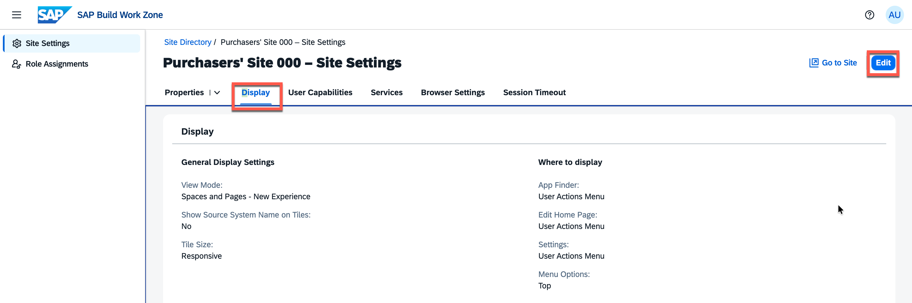
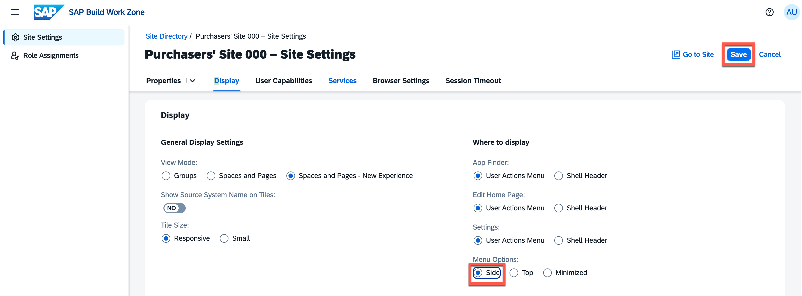
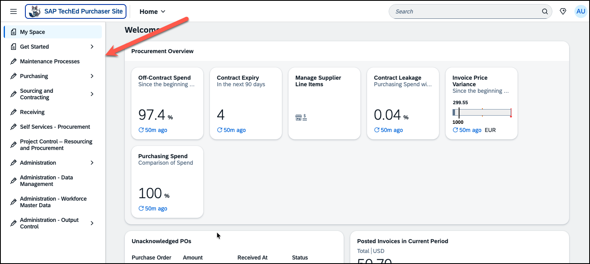
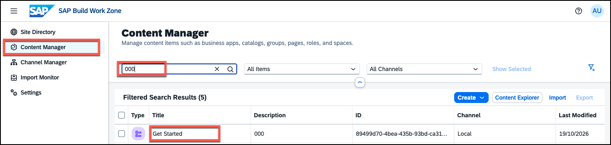
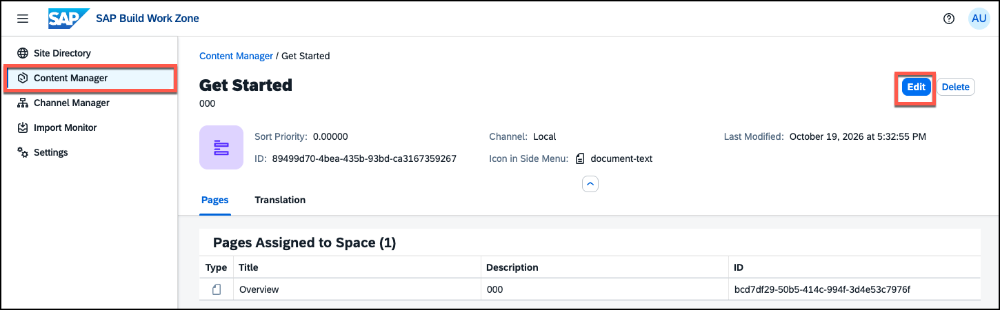
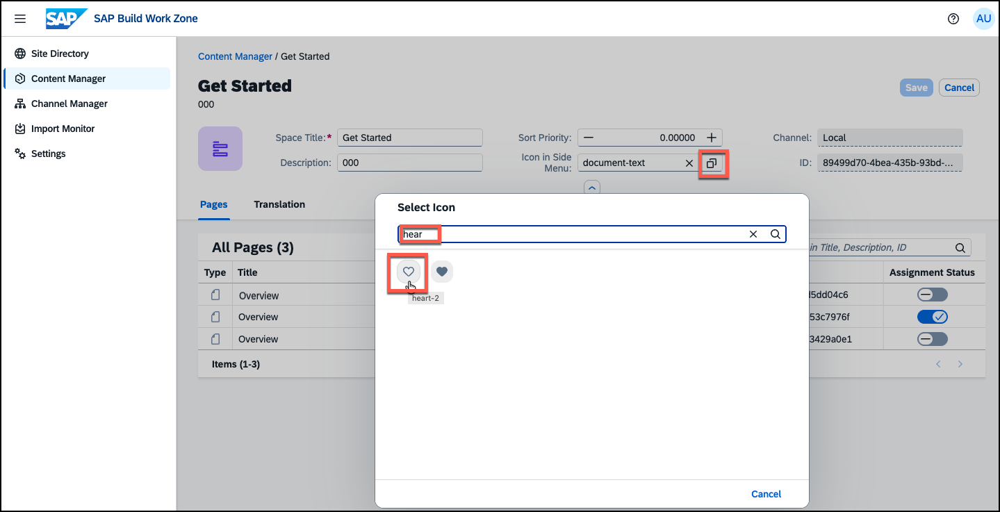
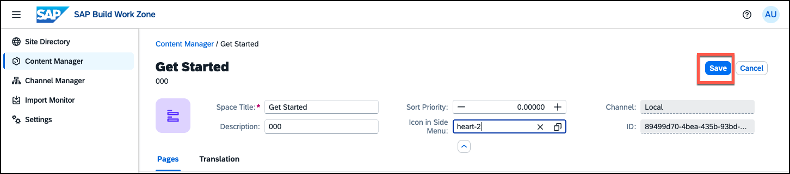
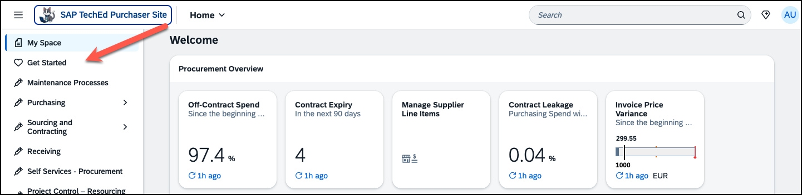

# Exercise 7 (Optional) - Change the Site Navigation to Side Menu

In this optional exercise, you will switch the site navigation from the default top bar to a side panel. You will also update the icon of the space you created earlier so it displays correctly in the new side menu.

> [!NOTE]
> The navigation menu style is a site-wide setting that affects all users. Side navigation gives more horizontal space to page content, which can be useful on widescreen displays or when spaces have longer names. Users can still access all the same spaces and pages — the structure does not change, only the presentation.

---

##  Exercise 7.1 - Switch to Side Navigation and Update the Space Icon

### What you'll achieve
After completing these steps the site navigation will switch from a top bar to a side panel, and your custom space will display a custom icon in the side menu.

---

### Steps

1. **Access the admin environment** — navigate back to the tab with the administration environment if you still have it open.

2. **Open the Display settings** — access the **Site Settings** of your site again and navigate to the **Display** tab.

   

3. **Switch to Edit mode** — click the **Edit** button in the top right corner.

4. **Choose menu option *Side*** — there are three menu options available: Side, Top, and Minimized. *Top* is what was used so far, *Minimized* means that the menu is hidden and only shown when the *Menu* icon is clicked. Select **Side** to test it.

   

5. **Save and view** — save your changes and click **Go to Site** to observe the result in the site.

   Notice that the spaces are displayed with icons in the side menu. The icons for the federated spaces come from the content provider system (in this case SAP S/4HANA) and cannot be changed here, but you can change the icon of the space you created earlier.

   

6. **Access Content Manager** — go back to the tab with the administration environment and navigate to the **Content Manager**. You need to use the breadcrumb to go back to the **Site Directory** first.

7. **Open the space** — identify your *Get Started* space and open it. 

   

   

8. **Click `Edit`** to switch to edit mode.

8. **Change the icon** — click the selector icon next to the *Icon in Side Menu* entry and choose a new icon, e.g. the *cloud* icon or the *heart-2* icon.

   

   

9. **Save and view** — save your changes and navigate to the **Site Directory** to reload your site by clicking the **Go to Site** icon. Notice the new icon in the side menu.

   

---

## Summary

You have switched the site navigation to a side panel and updated the space icon. Both changes take effect immediately for all users of the site.

Thank you for participating in **AD165 - Boost user productivity with AI assistant Joule and personal My Space for SAP Build Work Zone**.
