# Exercise 8 (Optional) - Create, Package, and Deploy Your Own UI Integration Card

In this exercise, you will enrich your workpage with a UI integration card that you configure yourself. UI integration cards are compact, data-rich components that display live information from business systems directly on a Work Zone page — without the user needing to open a full application. You will get a card from the Card Explorer, give it a unique ID, then use SAP Business Application Studio to wrap it in a content package, upload it to Work Zone, and add it to your page.

> [!NOTE]
> UI integration cards are based on the open SAP UI5 card standard. They can show lists, tables, objects, and analytical data from any OData or REST service. Cards are defined entirely by a `manifest.json`. A **content package** is a ZIP file that bundles one or more cards together with the access roles that control who can see them — it is the deployment unit for Work Zone. SAP Business Application Studio (BAS) provides tooling to validate and build content packages.

---

## Before You Start — Create Your Dev Space in Business Application Studio

Starting a dev space takes a few minutes. Kick it off now so it is ready when you reach Exercise 8.3.

1. Open **SAP Business Application Studio** - open (in a new window shift + left click) 👉  <a href="https://an4-a8rlu183.eu10cf.applicationstudio.cloud.sap/index.html" target="_blank">SAP Business Application Studio</a>.

   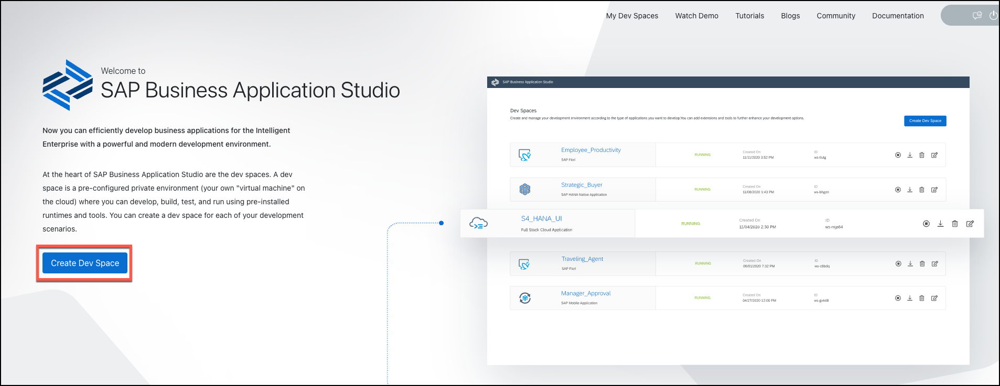

2. Click **Create Dev Space**.

3. **Enter a name** — e.g. **MyCard_###** with ### being your participant number. Keep the **SAP Fiori** selection, because this type of dev space already contains the Developer Tools for SAP Build Work Zone out of the box which will allow you to package your Content Package in Exercise 8.3. Then click **Create Dev Space**.

   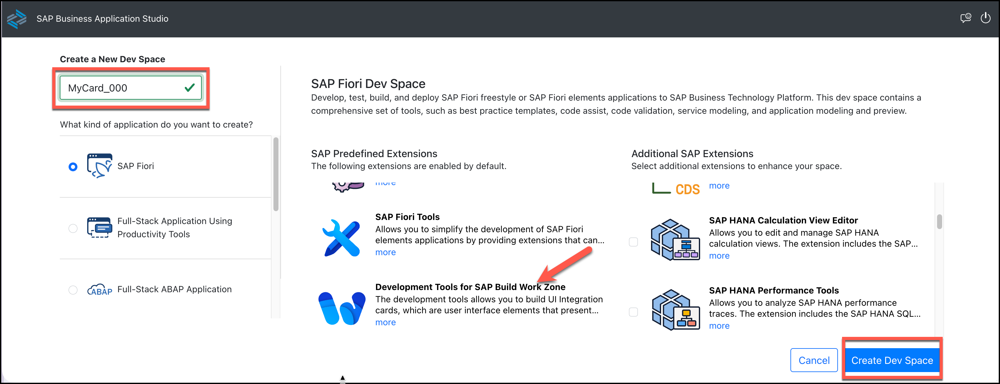

Your dev space is created and now starting.

---

## <a id="exercise-81-card-explorer"></a> Exercise 8.1 (Optional) - Explore the Card Explorer

### What you'll achieve
After completing this optional exercise you will be familiar with the Card Explorer and understand the basic structure of a UI integration card manifest.

---

The Card Explorer is an interactive playground for UI integration cards. It lets you preview different card types and inspect and edit a card's `manifest.json` side-by-side.

### Steps

1. **Open the Card Explorer** — right-click and select **Open in New Tab**: [Card Explorer](https://sapui5.hana.ondemand.com/test-resources/sap/ui/integration/demokit/cardExplorer/webapp/index.html#/explore/list). The page has three areas: left navigation (card types), a live preview in the center, and the `manifest.json` editor on the right.

2. **Skim the card types** — in the left navigation, browse: **List**, **Object**, **Table**, **Analytical**, **Calendar**, and others. These map to the `sap.card/type` field in the manifest.

3. **Understand the manifest anatomy** — in any List card example, note the key sections:
   - **`sap.app`** — card identity: `id`, `type`, `title`, `applicationVersion`
   - **`sap.card/type`** — the card type (e.g. `List`)
   - **`sap.card/header`** — title, subtitle, icon
   - **`sap.card/data`** — where the card fetches its data
   - **`sap.card/content`** — how to render the data. Most card types in the Card Explorer use static mock data, but in *Card Features > Data*, you can learn how to consume data from a real system via a BTP destination.  

   

---

## <a id="exercise-82-get-card"></a> Exercise 8.2 - Edit and Download Your Card from the Card Explorer

### What you'll achieve
After completing these steps you will have a card manifest with a unique ID ready to be added to a content package.

---

### Steps

1. **Check the List card in the Card Explorer** — in the [Card Explorer](https://sapui5.hana.ondemand.com/test-resources/sap/ui/integration/demokit/cardExplorer/webapp/index.html#/explore/list), you now see the list card (the card type is selected in the menu on the left). Make sure that you can see the manifest JSON code on the right side.

2. **Edit the card ID and title** — in the editor panel on the right, find the `"id"` field inside `"sap.app"` and change its value to `"teched.ad165.card###"` (replace `###` with your participant number). This is the **only required change** and makes sure your card ID does not conflict with other participants. In addition, change the title inside `"sap.app"` to `"Product List Card ###"`. This defines how the card will show up in the App Finder.

   Before:
   ```json
   "sap.app": {
		"id": "card.explorer.highlight.list.card",
      "type": "card",
		"title": "Sample of a List with Highlight",
    ...
   ```
   After:
   ```json
   "sap.app": {
		"id": "teched.ad165.card###",
      "type": "card",
		"title": "Product List Card ###",
    ...
   ```

   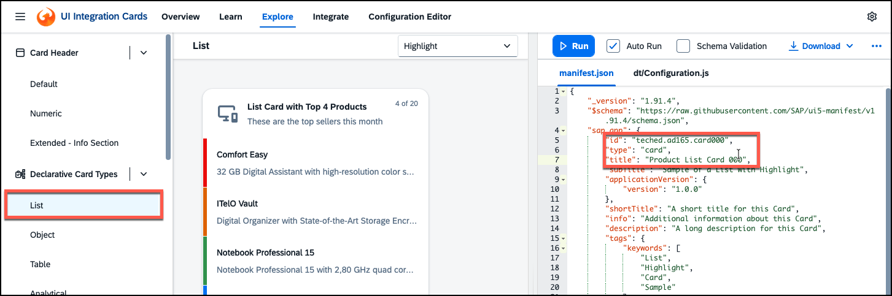

3. (Optional) **Edit the card title and subtitle** — find the `"header"` section inside `"sap.card"` and replace the parameter bindings with hardcoded values. In the sample card these values were set through the `configuration` section, which lets administrators change them when placing the card on a page. We are skipping the card configuration part to keep the exercise short.

   Before:
   ```json
   "header": {
       "title": "{{parameters.title}}",
       "subTitle": "{{parameters.subtitle}}",
   ```
   After (replace `###` with your participant number):
   ```json
   "header": {
       "title": "Products Low in Stock ###",
       "subTitle": "Reorder needed",
   ```

You immediately see your changes in the preview.

   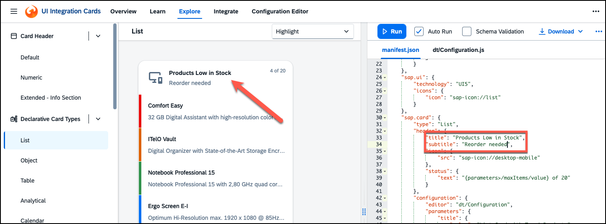

4. **Download the manifest** — click the **download link** (↓) above the manifest editor. Select **Manifest File** from the dropdown and save the downloaded `manifest.json` somewhere you can find it (e.g. your Desktop).

   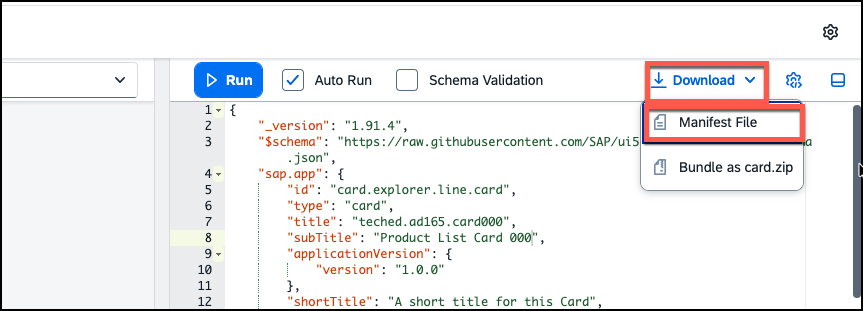

---

## <a id="exercise-83-bas-package"></a> Exercise 8.3 - Create a Content Package in SAP Business Application Studio

### What you'll achieve
After completing these steps you will have a `package.zip` content package ready to upload to Work Zone.

---

### Steps

#### Create the project

The Content Package template in BAS gives you a ready-made project scaffold including a `manifest.json` (the package descriptor), a `content.json` (the artifact registry), and sample files. Starting from this template saves you from creating the project structure from scratch and ensures it matches what the builder expects.

1. **Open the Dev Space** — go back to the tab with Business Application Studio. Your Dev Space should now be running. Click the name of your Dev Space to access it. In case, you receive a pop-up about Tracing, just confirm with **OK**. 

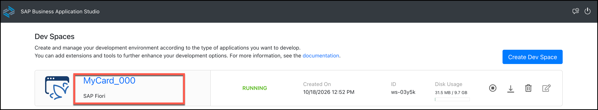

Business Application studio opens on the **Get Started** tab. If it is not visible, click the **Menu icon** and go to **Help** → **Get Started**.

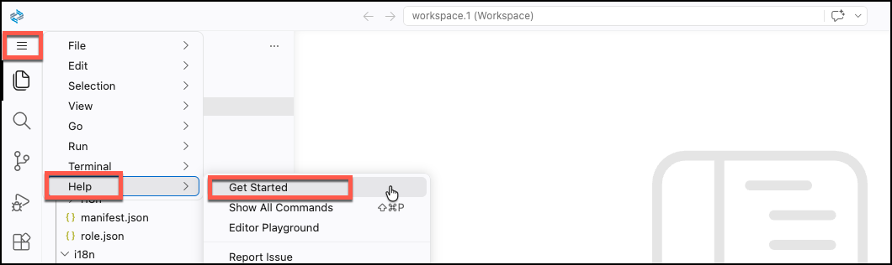

2. **Create a new project from template** — click **New Project from Template**.

   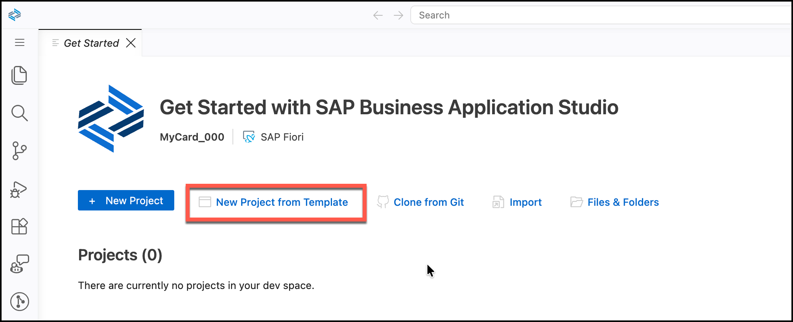

3. **Select the Content Package template** — Click the **Content Package** tile. You might need to scroll to see it. Then click **Start**.

   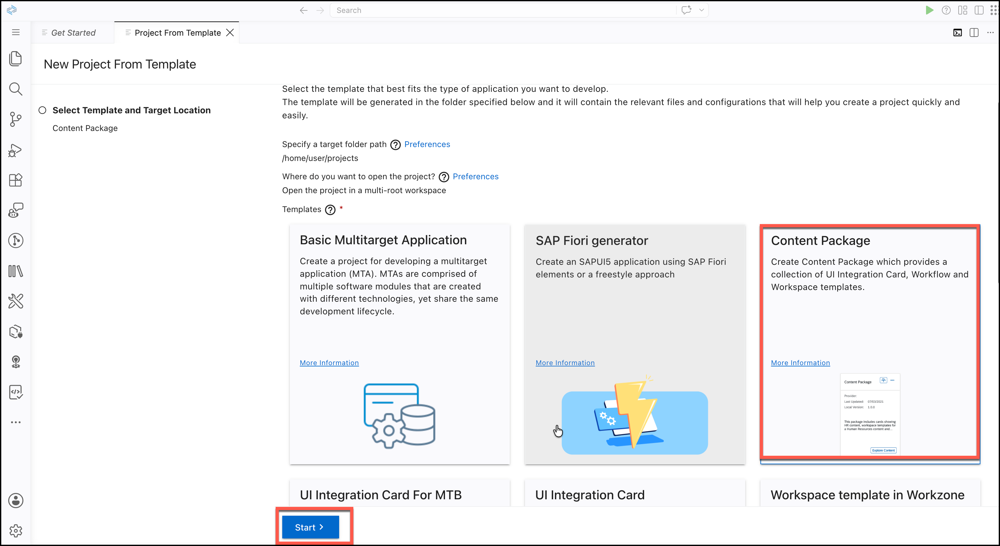

4. **Fill in the project details** — enter the following values, then click **Finish**:

   | Field | Value |
   |---|---|
   | Project Name | `ContentPackage###` |
   | Namespace | `ns` |
   | Title | `TechEd AD165 Package ###` |
   | Subtitle | `AD165` |
   | Include Content Samples | `True` |

   Replace `###` with your participant number. BAS creates the project and opens it. 
   
5. **Inspect the project structure** — take a look at the project structure that was created. It contains an `i18n` folder for translations which we will not cover in this exercise, a folder that holds the sample files that come with the template, a `content.json`, and a `manifest.json` file.

   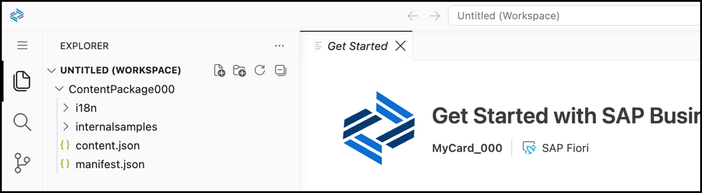

---

#### Add the card files

In the following steps you create a folder structure to upload the card manifest you downloaded from the Card Explorer in Exercise 8.2 and a role definition that links the role to your card. There might be already projects of other participants in the Dev Space. **Make sure to work in your own project structure**. 

6. **Create the folder structure** — in the Explorer panel on the left:
   - Right-click your project root → **New Folder** → name it `demo`
   - Right-click `demo` → **New Folder** → name it `src`

   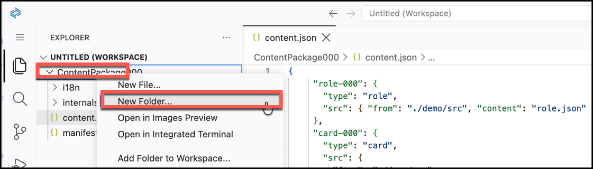

   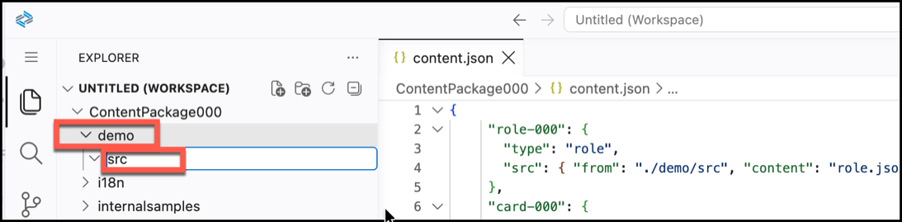

7. **Add the card manifest** — in the `demo/src` folder:
    - Right-click `src` → **New File** → name it `manifest.json`
    - Open the file and paste the card manifest JSON you edited in Exercise 8.2 (from your downloaded manifest.json or directly from the Card Explorer editor if it is still open).
    - Make sure the `"id"` in `"sap.app"` is still `"teched.ad165.card###"` with ### being your own participant ID.
    - Save the file (**Ctrl+S**).

    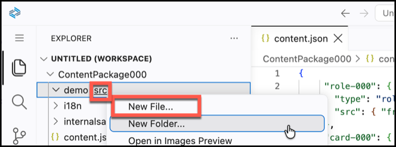

    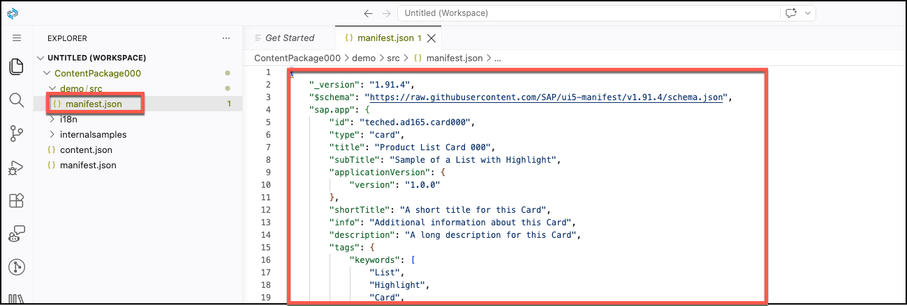

8. **Add the role definition** — in the same `demo/src` folder:
    - Right-click `src` → **New File** → name it `role.json`
    - Paste the following content. Replace `###` with your participant number.

    ```json
   {
     "_version": "3.2.0",
     "identification": {
         "id": "ns.package_ns.mycontentpackage###.sm",
         "title": "ContentPackageRole###",
         "entityType": "role"
      },
     "payload": {
         "apps": [
            {
               "id": "teched.ad165.card###.app"
            }
         ],
         "cards": [
            { "id": "teched.ad165.card###" }
         ]
      }
   }
    ```

    Save the file (**Ctrl+S**).

    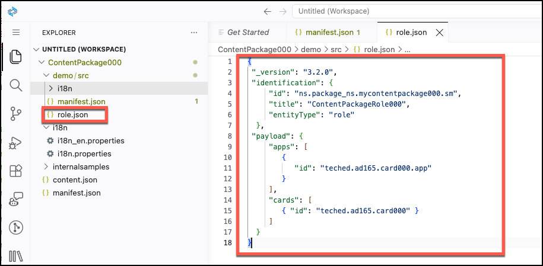

9. **Copy the i18n folder** — the card manifest references translation files from an `i18n` folder. Copy the one that was created with the content package template:

   - Right-click the `i18n` folder in your project root (`ContentPackage###`) → **Copy**

 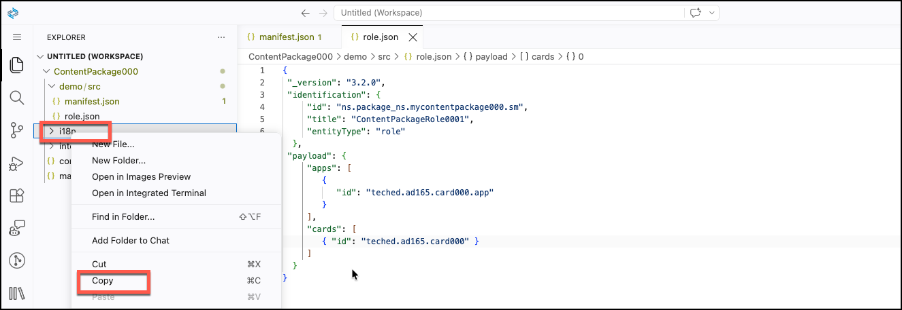

   - Right-click the `src` folder inside `demo` → **Paste**

 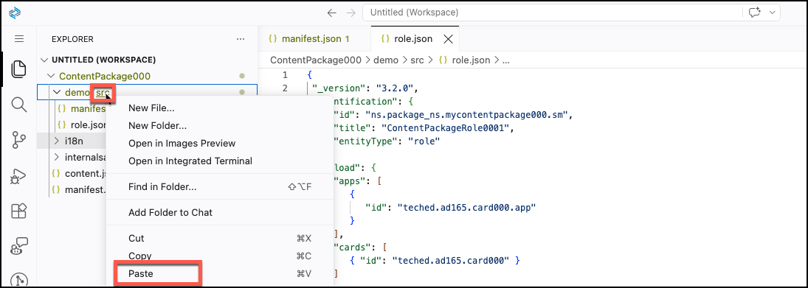

---

#### Edit the package content.json

With your card files in place, you now tell the content package builder which artifacts to include in the ZIP. `content.json` is the registry — each entry declares one artifact (here a **role** and a **card**) and points to its source files in the `demo/src` folder you just created.

10. **Replace the entire contents** of `content.json` with the following. Replace `###` with your participant number.

   ```json
   {
     "role-###": {
       "type": "role",
       "src": {
         "from": "./demo/src",
         "content": "role.json" 
       }
     },
     "card-###": {
       "type": "card",
       "src": {
         "from": "./demo/src",
         "path": "./",
         "build": "",
         "package": "",
         "manifest": "src/manifest.json"
       }
     }
   }
   ```

 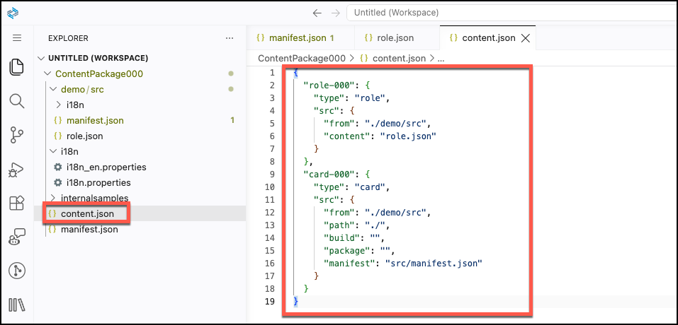
---

#### Build the package

With the card files in place and `content.json` updated, you are ready to produce the deployable ZIP. The builder validates your files, resolves all paths declared in `content.json`, and packages everything into `package.zip`.

11. **Build the content package** — in the Explorer panel, right-click the **`manifest.json` in the project root** (the package manifest, not the one inside `demo/src`). Select **Content Package: Package**. This usually just takes a few seconds.

    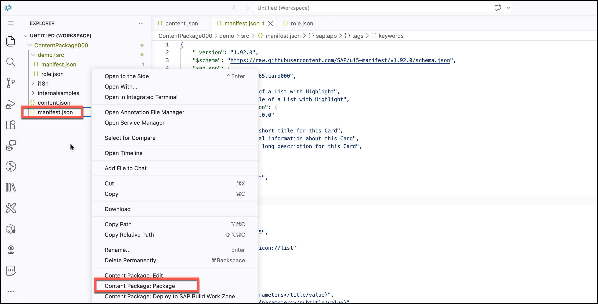

12. **Download the ZIP file** — when the build completes, `package.zip` appears in the project root. Right-click it and select **Download**. 

    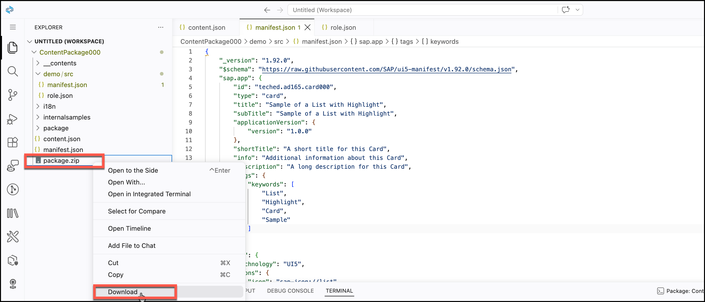

13. **Rename the downloaded file** to `ContentPackage###.zip`.

> [!IMPORTANT]
> If the **Content Package: Package** option does not appear in the right-click menu, the "Development Tools for SAP Build Work Zone" extension is not enabled in your dev space. Stop the dev space, enable the extension (click Edit on the dev space), restart it, and try again.
> If you receive an error message, verify that: (1) you right-clicked the package root `manifest.json` (not the card manifest in `demo/src`) to build and (2) you selected `Content Package: Package`. 

---

## <a id="exercise-84-upload"></a> Exercise 8.4 - Upload the Content Package to SAP Build Work Zone

### What you'll achieve
After completing these steps your card package will be available in the Content Manager, ready to be placed on a page.

---

### Steps

1. **Open the Channel Manager** — in the Work Zone administration environment, click **Channel Manager** in the left-hand navigation.

2. **Add a new Content Package** — click **Add** and select **Content Package**.

   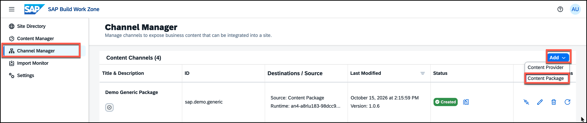

3. **Select your ZIP** — in the upload dialog, click **Browse** and select `ContentPackage###.zip`.

4. **Select the Runtime destination** — select **S4HANA_RT** as the runtime destination. Since you only use mock data in your card for now, it does not really matter which destination you select, but as it is a mandatory field, just choose one.

5. **Save** — click **Save**. Work Zone validates and imports the package. You should see it appear in the Content Channels list with the name *TechEd AD165 Package ###*. Note that this can sometimes take some time.

   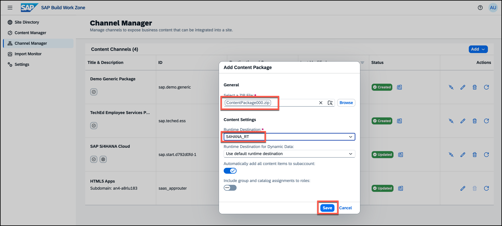

   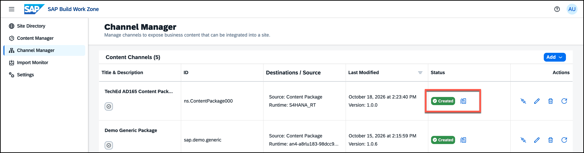

6. While you are waiting, please ask one of your instructors already now to assign **TechEd AD165 Role ###** to your user. This is required for the card to be visible later after adding it to your page.

> [!IMPORTANT]
> If the upload fails with a validation error or the new channels has an orange *Created* status, verify that: (1) you right-clicked the package root `manifest.json` (not the card manifest in `demo/src`) to build; (2) all `###` placeholders were replaced with your participant number, and (3) the card `id` `teched.ad165.card###` matches in the card manifest and the role.json. You can click the **Report** icon to learn more about the issue.

   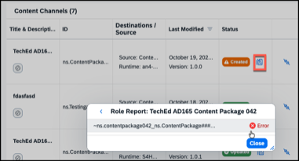


> If you need to make corrections, you can either delete the current package and create a new one or update the content package using the *Update* icon. In this case, make sure to increase the package version in the manifest.json file.

  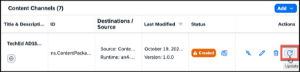

---

## <a id="exercise-85-add-to-page"></a> Exercise 8.5 - Add the Card to Your Page

### What you'll achieve
After completing these steps your card will appear on the page you built in Exercise 3.

---

### Steps

1. **Open your page** — navigate to the **Content Manager**, find and open the page you created in Exercise 3.1.

   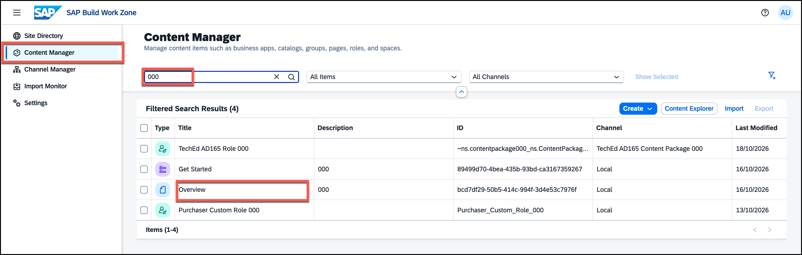

   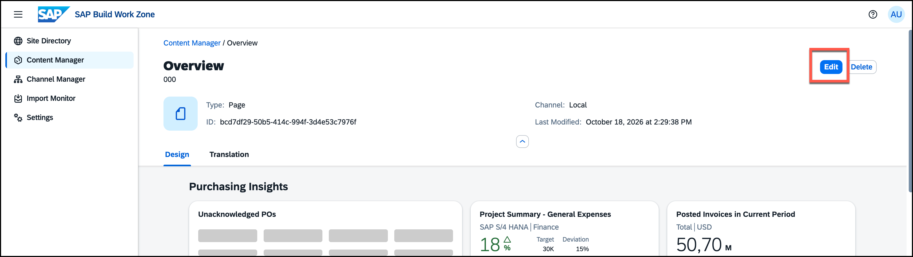

2. **Enter edit mode** — click the **Edit** button.

3. **Add the card** — click the **+** sign in any section on your page, then click **Add Content**.

   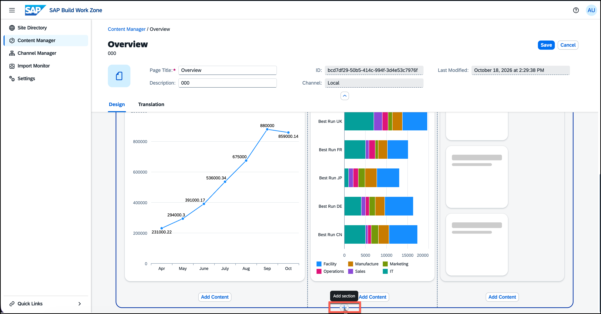

4. **Find your card** — in the App Finder, select **Cards** and search for your participant number **###**. Select **Product List Card ###** (or the title you set in Exercise 8.2).

   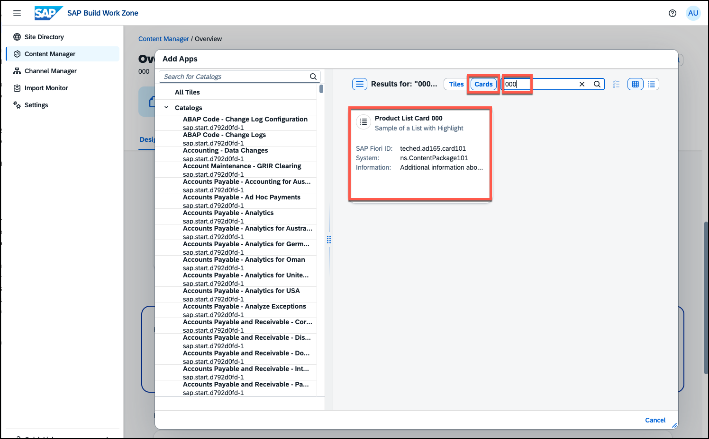

5. **Save your changes.**

   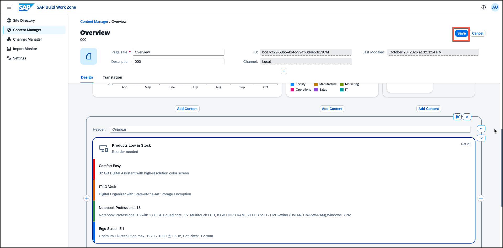

---

## <a id="exercise-86-assign-role"></a> Exercise 8.6 - Assign the Package Role to Your Site

### What you'll achieve
After completing these steps the role from your package will be assigned to your site, making the card visible to users who have that role.

---

### Steps

1. **Open your site settings** — navigate to **Site Directory** and open your site settings by clicking the cog icon.

   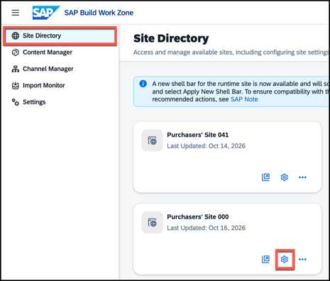

2. **Open Role Assignments** — in the left-hand navigation, click **Role Assignments** and confirm you are on the **Roles** tab.

3. **Switch to Edit mode** — click the **Edit** button.

   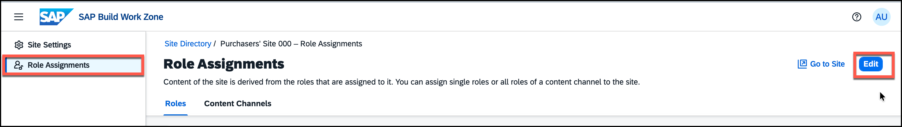

4. **Find your role** — search for your participant number `###`. You should see **ContentPackageRole###**.

5. **Assign the role** — toggle its switch to **On** in the *Assignment Status* column.

6. **Save your changes.**

   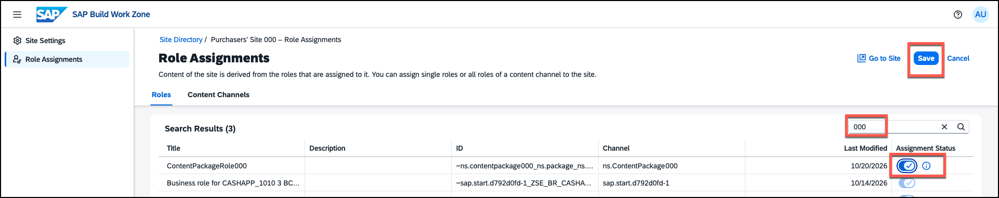
---

## <a id="exercise-87-preview"></a> Exercise 8.7 - Preview Your Site

### What you'll achieve
After completing these steps you will see your card live in the site.

---

### Steps

1. **Open the site** — navigate to **Site Directory** and click the **Go to Site** icon on your site.

   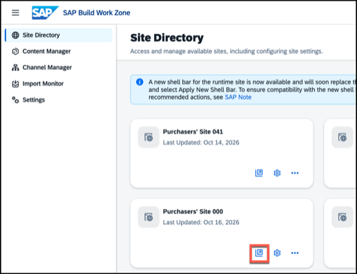

2. **Navigate to your page** — go to the space and page from Exercise 3.

3. **Verify the card** — your card should be visible on the page.

   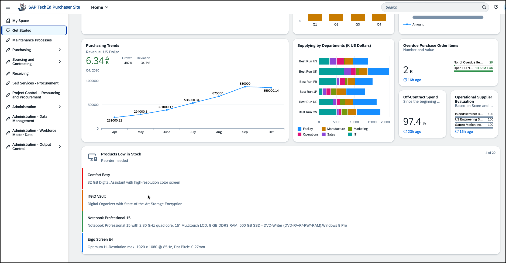

---

## Summary

You edited a card in the Card Explorer, used SAP Business Application Studio to wrap it in a content package, uploaded the package via the Channel Manager, placed it on your page, and assigned the access role. You have now completed the full card development-to-deployment lifecycle.

Return to - [Main README](../../README.md)
